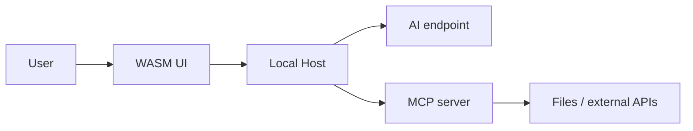

# Security model

Status: Accepted

## Endpoint credentials

Endpoint profile metadata is stored in the project JSON document. API keys are excluded from that document and are stored by the Host gateway in a separate local file protected with Windows DPAPI (`CurrentUser`). The WebAssembly client receives only a `HasCredential` flag. When a saved profile is selected for a chat request, the Host resolves its credential locally before calling the OpenAI-compatible endpoint.

## Current security settings API

Project access settings are changed by a single revisioned operation `PUT /api/projects/{projectId}/security`. One request contains the complete set of directory grants, MCP server bindings, and per-tool policies; the Host validates them as a single state and saves them atomically. A revision mismatch returns `409 Conflict` and does not apply a partial change.

A tool policy can only reference an MCP server that is present in the same settings document. The UI can discover tools through the MCP connection and offers the Host's built-in defaults for known tools. Unknown and external tools begin at `Ask`.

## Trust boundaries



Untrusted inputs:

- user text;
- AI responses;
- Markdown and links;
- tool descriptions and annotations of an unknown MCP server;
- model tool arguments;
- tool results;
- remote OAuth metadata before validation;
- paths passed through the UI or the model.

## Tool policy

For each project and each ToolIdentity, the following is stored:

```text
Allow — permit the call within the given constraints
Ask  — request confirmation before the call
Deny — do not show the tool to the model and reject direct calls
```

The initial policy for any new or changed external tool is `Ask`. Known Host tools that only read local files or application data, search, wait, ask the user, or navigate the app have explicit `Allow` defaults. Network fetches, writes, process and script execution, skill execution, and delegation still start at `Ask`. Unknown Host tool names also start at `Ask`.

A change in tool schema hash resets the stored permission. `notifications/tools/list_changed` triggers re-evaluation.

## Decision making

```text
Server enabled?
→ Tool descriptor valid?
→ ToolPolicy exists and schema hash matches?
→ Argument constraints satisfied?
→ Directory grant satisfied?
→ OAuth/server authorization satisfied?
→ Allow / Ask / Deny
```

The most restrictive result wins. A tool annotation cannot weaken the project policy.

## Chat approval mode

Each chat has a mode, chosen in the composer next to `+`, that answers a call its policy leaves at
`Ask` before any card is shown. `Deny`, the per-run call limits and directory grants apply in every
mode; the mode never touches them.

```text
Ask for approval — every such call waits for the approval card (the default, and every older chat)
Approve for me   — the chat-tool-risk-assess executor judges the call; only "allow" with risk
                   "low" runs without a card, anything else (including a failed or unreadable
                   assessment) shows the card with the assessment's reason
Full access      — every such call runs without asking
```

In "Ask for approval" mode the assessment is only advice, so the card does not wait for it: the card
is shown at once and the assessment's reason joins it when it arrives, if the card is still waiting.
A background run that has nobody to ask refuses the call without an assessment.

The assessment is one model call on the chat's own connection. It sees the user's last three
messages on the branch, so that a short follow-up such as "go on" is read with the task it
continues, the playbook the chat is following (found from its `run_skill` call within the last few
turns, with the text taken from the skill catalog rather than from the call), whether that playbook
lists the tool among its `allowed-tools`, the project's directory grants, the tool's description and
annotations (as unverified hints) and the exact arguments, all passed as data. A step of the
active playbook counts as asked for by the user; it never lifts the rules on secrets, paths outside
the project, uploads, deletion or history rewrites. For a `process_run` call it also sees the
command as the Host parsed it, with the guard's findings and the command rule that matched (see
[Command rules](#command-rules)); a rule that asks about the command is never overridden by the
assessment. Switching the mode while a card
waits answers it: Full access lets the call through, and "Approve for me" gets one assessment.
Background subtasks, which have nobody to ask, run what the parent chat's mode would allow and
refuse the rest. Before delegation the parent is shown the effective state of available execution
tools. When a subtask requires a tool that would be refused and no already-allowed equivalent can
do the work, the parent asks the user first and stores the narrowest suitable tool or command rule;
it does not broaden permission merely to avoid using an allowed alternative. A chat not created yet
keeps the mode picked in its composer and is created with it.

## Command rules

`process_run` starts any program, so one permission for the whole tool is either too broad or asks
about every `git status`. Command rules decide its calls by what they run, and the file tools' calls
by the paths they change. A rule is a tool, a pattern, a decision (`Allow`, `Ask`, `Deny`) and a
scope (global, project or chat); they are stored in `command-rules.json` beside `settings.json`,
apart from chats and projects.

Deciding, scoping, storing and showing rules are the same for every tool. What differs lives in the
tool's rule profile (`IToolRuleProfile`): how its patterns are written, how a call of it reads
(`RuleSubject`: what it does, its warnings, whether the guard stops an Allow, whether only an exact
pattern may allow it, what the card offers to remember), and whether the call runs pinned to what
was checked. `ToolRuleProfiles` lists the profiles, and `CommandRule.Tools` names the same tools for
the web; a new tool takes rules by adding a profile there.

```text
git status *              Allow   project
git diff *                Allow   global
dotnet test *             Allow   project
git push *                Ask     project
git push --force *        Deny    global
pwsh -NoProfile -File scripts/check.ps1   Allow   project
```

**Reading the call.** The Host parses the call before any rule is checked
(`Application/Tools/Commands`):

- The program is resolved through PATH, as `process_run` would start it, and named the way rules
  name it: the file name without `.exe`, in lower case where names ignore case. `GIT.EXE`,
  `C:\Program Files\Git\cmd\git.exe` and `git` are all `git`. The call then runs the resolved file,
  so what was checked is what starts.
- Git's own options before the subcommand (`-C`, `-c`, `--git-dir`, …) are set apart from the
  subcommand and its arguments, which are what patterns match. A forced push is spelled one way:
  `push -f`, `push -uf` and a `+refspec` all carry `--force`.
- Every argument that names a path, including the values of `-C`, `--git-dir`, `--work-tree` and
  `--output`, is resolved against the working directory.

**Matching.** A pattern is the program's name, then words compared one by one with the subcommand
and its arguments. A word matches one argument exactly, or as a mask when it holds `*` or `?`, which
stand for characters inside that one argument (`--force*`). A lone `*` as the last word matches any
further arguments, none included; without it the command must end where the pattern does. A word
with a space is written in double quotes, with a quote inside doubled. There are no regular
expressions, and no masks in the program's name.

**Deciding.** Inside the tool's own policy — a denied `process_run` stays denied — a matching rule
decides:

1. a matching `Deny` wins;
2. otherwise the most specific pattern: more words matched exactly, then a pattern without the
   trailing `*`, then more literal characters;
3. between equally specific patterns the narrower scope: chat, then project, then global.

With no matching rule the tool's own policy applies. Two kinds of command are allowed only by a
pattern that spells them exactly: a shell, script host or launcher (`pwsh`, `bash`, `cmd`, `python`,
`node`, `npx`, `env`, a `.cmd` or `.ps1` file, …), whose arguments are a program of their own, and a
command that can discard work or rewrite history (`push --force`, `reset --hard`, `clean -f`,
`branch -D`, `checkout -- .`, `restore`, `rebase`, …). A broader `Allow` does not reach them; a `Deny`
or `Ask` does.

**The guard.** An `Allow` never lets a call through unasked when the guard stops it; the call is
asked about instead, with the reason on the card:

- the program is not found, or the file is not the one PATH finds for its name (a `git.exe` in the
  project), or it lies inside the project or the working directory;
- an option makes the program run other commands: git's `-c`, `--config-env`, `--exec-path`,
  `--upload-pack`, `--receive-pack`, `--exec`, and `clone -u`;
- the call gives no working directory, or a working directory or a path outside the project's
  directory grants.

The repository's own configuration is trusted: an alias or a hook defined in `.git/config` runs
under a rule that allows the command which triggers it.

**Remembering from the card.** The approval card of a `process_run` call shows the parsed command
and the guard's findings. Its Allow menu offers to remember the subcommand (`git log *`, preselected),
the exact command, or the whole program, for the chat, the project or every project; a shell or a
destructive command is offered only as itself, and an argument holding `*` or `?` offers no pattern,
since it would read back as a mask. The Host computes the offered patterns and accepts only one of
them, so a client cannot widen what the person saw. Remembering "Any process_run call" saves a
policy for the whole tool, as before.

Each rule names the tool it decides (`Tool`, `process_run` when absent); `process_run` is the only
one so far, and every place that lists or writes rules groups them by tool so that others can join.
Global rules are written in the global tool settings: on the Tools page of the built-in server,
expanding a tool that takes rules shows them beside its limits, where they are added with a pattern
and a decision, changed and removed, and saved at once rather than with the settings' Save. A
project's tool permissions do the same for the project's rules and can also add a global one. A
chat's and a branch's tool permissions only list the rules that apply and reset the chat's own; the
chat's rules come from its approval cards. Rules are read with
`app_read` `CommandRules`, changed with `app_security` `SetCommandRule` and `RemoveCommandRule`, and
served at `/api/settings/command-rules`.

### Path rules for the file tools

`write_file`, `edit_file`, `create_directory`, `move_file`, `delete_file`, `delete_directory`,
`zip_create` and `zip_extract` take rules by the paths they change (for a move both paths, for an
archive the file or folder it writes; paths a call only reads are not matched).

```text
write_file      docs/**          Allow   project
edit_file       src/**/*.cs      Allow   project
delete_file     build/out.log    Allow   project
write_file      deploy/**        Deny    global
```

- **Pattern.** A path below the project's directories, with `/` between folders (`\` is read as
  `/`): `*` and `?` mask characters inside one name, `**` as a whole part stands for any number of
  folders, none included. A full path (`C:/work/notes.md`) matches only there. `.` and `..` parts
  are refused. Names compare without case where the file system ignores it.
- **Matching.** A path is matched by its parts below the directory grant that holds it. A call that
  names several paths needs all of them to match an `Allow` or `Ask`, and any one to match a `Deny`.
- **Guard.** An `Allow` never lets a call through unasked when it changes a path outside the
  project's directory grants, anything under `.git` (hooks and config can make git run code), or a
  file that may hold secrets (`.env`, `.env.*`, `.ssh`, `.aws`, `.npmrc`, `id_rsa*`, `*.pem`,
  `*.key`, …). A deletion is allowed only by its exact path.
- **Card.** It offers the folder with everything below it (`src/app/**`, preselected), the exact
  path and the whole project (`**`); a deletion only its exact path.

## Directory grants

Permissions are defined separately for tools. Directory grants are an additional restriction on FileSystem tool arguments:

```text
DirectoryGrant
├─ CanonicalRoot
├─ Recursive
├─ IncludePatterns[]
├─ ExcludePatterns[]
└─ ToolNames[]
```

For example, `read` may have access to the entire project root, while `write` and `edit` only to `src` and `docs`. `delete` can be `Deny` regardless of directory grants.

Server-side checks:

- `Path.GetFullPath` and platform-aware comparison;
- containment check after normalization;
- protection against `..`;
- symlink/junction/reparse point check;
- re-check immediately before modification;
- size and result count limits;
- prohibition of broad roots without explicit confirmation.

Implemented in the built-in server: `ToolNames` are treated as a capability (`read`, `write`, `edit`, `delete`) and passed to the server when opening a session; `PathGuard` performs canonicalization, reparse point resolution along the entire chain, containment with regard to `Recursive`, and capability verification. The Host adds a private OS temporary directory grant for the current chat, even when the project has no directory grants. Project-level path checks (`ProjectPathAccess`) also treat the project's scratch space as readable and writable, so links and previews of scratch files work. Sessions without a chat still reject FileSystem access when grants are absent. `IncludePatterns`/`ExcludePatterns`, a dedicated delete tool, and the prohibition of broad roots are not yet implemented. Details and limits: [default tools](16-default-mcp-tools.md).

## Approval dialog

Displays:

- project;
- MCP server and trust status;
- tool name/title;
- annotations as hints;
- arguments;
- canonical target;
- diff for `edit`;
- expected effect;
- missing scopes;
- timeout and limits.

Options:

- allow once;
- allow until the end of the current AgentRun;
- save `Allow` for the current ToolIdentity;
- deny;
- save `Deny`.

A persistent permission is not transferred between projects.

## Hosted WASM security

The Host listens only on loopback by default and serves WASM and API from a single origin. Required:

- HttpOnly, SameSite session cookie;
- CSRF/origin validation for mutating requests;
- Content Security Policy;
- prohibition of arbitrary MCP executable/arguments from the browser;
- Markdown sanitization;
- no secrets in WASM configuration, logs, or JSON history;
- size limits for requests and streaming frames.

## stdio proxy risk

The web-to-stdio bridge is a privileged boundary. The Host only launches entries from the local registry created by the user outside the model-controlled flow. The executable path is canonicalized, the configuration is signed or protected against unnoticed substitution, and all launches are logged. For third-party servers, sandbox/process isolation is recommended.

Official guide: [MCP Security Best Practices](https://modelcontextprotocol.io/docs/2025-11-25/tutorials/security/security_best_practices).

## Markdown

Pipeline:

```text
Markdown source
→ Markdig with raw HTML disabled
→ HtmlSanitizer allowlist
→ safe Blazor MarkupString
```

Only necessary tags, attributes, and URI schemes `http`/`https` are allowed. `javascript:`, event attributes, embedded forms, and active SVG are forbidden.

## Credentials

- Web stores only `CredentialReference`.
- The Host stores secrets in a protected local credential store.
- On Windows, key material is protected by the current user/OS.
- Secrets are edited through a masked UI and are never returned in full.
- Logs use redaction for headers, query parameters, and JSON properties.

## Audit

Project/policy changes, approvals, denials, MCP process starts, tool calls, canonical targets, result status, hashes, and correlation IDs are recorded. Secrets and full sensitive content are not written to the audit log.

# Current scope

The global Security section in the current iteration is an informational page. Directory access is set only at the project level:

- `Read only`;
- `Read/write`;
- access is always recursive;
- the canonical path of a symbolic link or junction cannot escape the grant boundaries;
- when directories intersect, the most specific grant applies.

MCP policy is set globally at the MCP server level and is not overridden by the project.

## Application management tools

The Host ships its own MCP server [App tools](17-app-tools.md), which reads and changes application data. It passes the same checks as any other server: global and project-level enablement, per-tool policy, policy reset on schema hash change, confirmation before invocation.

There are no special restrictions on privilege escalation: with an `Allow` policy, the `app_security` tool can expand its project's directory grants, change the policy of any tool, and enable arbitrary MCP servers. This is a deliberate decision for a local single-user application — the agent already runs with the user's account permissions and has `process_run`. The only boundary is the default `Ask` policy and the confirmation card. Rationale: [ADR-007](decisions/ADR-007-in-process-app-tools.md).

Secrets remain one-way here as well: a key can be written but not read, and when global settings are replaced, the presence flags of secrets are recalculated from the protected store.
