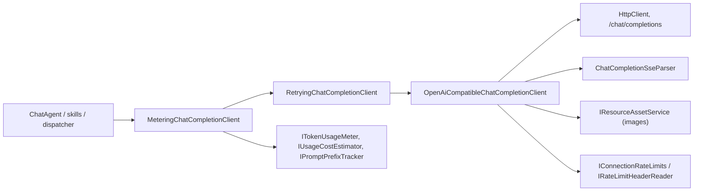

# `S1` — AI model interaction: current state

Owner: Ada · AI models. Seam `S1` of the redesign analysis (see [README.md](README.md)).
Every statement below is verified against the source at the cited `path:line`; statements that come
from `docs/` instead of code are marked as such, and anything not verified is marked `assumption:`.

## 1. Scope

Everything in the monolith that talks to an AI model provider, plus the parts that exist only to
serve that conversation:

- provider clients and their chain (`OpenAiCompatible…`, `Retrying…`, `Metering…`), SSE stream
  parsing, transport timeouts, retries and rate-limit observation;
- the agent loop and tool calls (`ChatAgent`, tool sessions, tool decision policy) as a *consumer*
  of the model;
- request composition: hidden instructions, context assembly and planning, token estimation,
  history compaction and its budgets;
- token, cost and prompt-prefix accounting;
- connections and secrets as model input;
- skills that call the model themselves (`GenericSkillExecutor`, `SkillRunner`);
- the SSE/event points through which a model answer reaches the client.

Out of scope: metadata and byte storage (seams `S2` and `S3`), and the UI fold.

## 2. Current structure

### 2.1 Layers and projects

The AI-model area lives in one project, `src/AI.Server`, split by layer:

| Concern | Location |
| --- | --- |
| Application contracts and policy | `src/AI.Server/Application/Chat/`, `Application/Usage/`, `Application/Tools/`, `Application/Skills/` |
| Provider transport and parsers | `src/AI.Server/Infrastructure/Chat/` |
| Consumption from a run | `src/AI.Server/Application/Runs/` |
| HTTP surface | `src/AI.Server/Hosting/Endpoints/` |
| Shared wire types | `src/AI.Contracts/` (`Chat/`, `Usage/`, `Runs/`, `Settings/`) |

There is no separate assembly for model interaction: the provider client, the agent loop and the
chat-run dispatcher are compiled into `AI.Server` and instantiated by one Pure.DI composition
(`src/AI.Server/Composition.cs:164`–`172`).

### 2.2 The client chain

`IChatCompletionClient` has exactly two operations
([`IChatCompletionClient.cs:4`](file:///C:/Projects/DevTeam/AI.Client/src/AI.Server/Application/Chat/IChatCompletionClient.cs#L4)):
`CompleteAsync` and `StreamAsync`. Three implementations decorate one another:

The composition builds exactly that order in one binding:
`new MeteringChatCompletionClient(new RetryingChatCompletionClient(baseClient, …), …)`
([`Composition.cs:164`](file:///C:/Projects/DevTeam/AI.Client/src/AI.Server/Composition.cs#L164),
[`Composition.cs:171`](file:///C:/Projects/DevTeam/AI.Client/src/AI.Server/Composition.cs#L171)),
with the transport client registered as the tagged singleton `"base"`
([`Composition.cs:101`](file:///C:/Projects/DevTeam/AI.Client/src/AI.Server/Composition.cs#L101))
and a single process-wide `HttpClient` whose own timeout is disabled
([`Composition.cs:98`](file:///C:/Projects/DevTeam/AI.Client/src/AI.Server/Composition.cs#L98)):
all timing is the transport policy's, not the HTTP stack's.

- **Transport** — `OpenAiCompatibleChatCompletionClient` takes `HttpClient`,
  `IChatCompletionSseParser`, `IChatTransportPolicy`, `IChatCompletionUsageReader`,
  `IRateLimitHeaderReader`, `IConnectionRateLimits`, `IClock` and `IResourceAssetService`
  ([`OpenAiCompatibleChatCompletionClient.cs:13`](file:///C:/Projects/DevTeam/AI.Client/src/AI.Server/Infrastructure/Chat/OpenAiCompatibleChatCompletionClient.cs#L13)).
  Both operations post to `<BaseUrl>/chat/completions`
  ([line 56](file:///C:/Projects/DevTeam/AI.Client/src/AI.Server/Infrastructure/Chat/OpenAiCompatibleChatCompletionClient.cs#L56),
  [line 214](file:///C:/Projects/DevTeam/AI.Client/src/AI.Server/Infrastructure/Chat/OpenAiCompatibleChatCompletionClient.cs#L214))
  and authenticate with a bearer token taken from the request's `ApiKey`
  ([line 59](file:///C:/Projects/DevTeam/AI.Client/src/AI.Server/Infrastructure/Chat/OpenAiCompatibleChatCompletionClient.cs#L59)).
  It validates the request before sending: the base URL must be absolute `http`/`https`, the model
  non-empty, and either a message or context messages present
  ([lines 40](file:///C:/Projects/DevTeam/AI.Client/src/AI.Server/Infrastructure/Chat/OpenAiCompatibleChatCompletionClient.cs#L40)–[51](file:///C:/Projects/DevTeam/AI.Client/src/AI.Server/Infrastructure/Chat/OpenAiCompatibleChatCompletionClient.cs#L51)).
  A non-success status becomes `ChatEndpointException`, which carries the status code and a parsed
  `Retry-After` ([`ChatEndpointException.cs:11`](file:///C:/Projects/DevTeam/AI.Client/src/AI.Server/Infrastructure/Chat/ChatEndpointException.cs#L11),
  [`OpenAiCompatibleChatCompletionClient.cs:226`](file:///C:/Projects/DevTeam/AI.Client/src/AI.Server/Infrastructure/Chat/OpenAiCompatibleChatCompletionClient.cs#L226)–[231](file:///C:/Projects/DevTeam/AI.Client/src/AI.Server/Infrastructure/Chat/OpenAiCompatibleChatCompletionClient.cs#L231)).
  Rate-limit headers are recorded against the connection on both success and refusal
  ([line 148](file:///C:/Projects/DevTeam/AI.Client/src/AI.Server/Infrastructure/Chat/OpenAiCompatibleChatCompletionClient.cs#L148)–[151](file:///C:/Projects/DevTeam/AI.Client/src/AI.Server/Infrastructure/Chat/OpenAiCompatibleChatCompletionClient.cs#L151)).
- **Retry** — `RetryingChatCompletionClient` wraps the transport and retries rate limits without a
  ceiling and server faults up to `MaxServerFaults = 5`
  ([`RetryingChatCompletionClient.cs:17`](file:///C:/Projects/DevTeam/AI.Client/src/AI.Server/Infrastructure/Chat/RetryingChatCompletionClient.cs#L17),
  [line 34](file:///C:/Projects/DevTeam/AI.Client/src/AI.Server/Infrastructure/Chat/RetryingChatCompletionClient.cs#L34),
  [line 37](file:///C:/Projects/DevTeam/AI.Client/src/AI.Server/Infrastructure/Chat/RetryingChatCompletionClient.cs#L37)),
  backing off from 1 s to 60 s
  ([lines 35](file:///C:/Projects/DevTeam/AI.Client/src/AI.Server/Infrastructure/Chat/RetryingChatCompletionClient.cs#L35)–[36](file:///C:/Projects/DevTeam/AI.Client/src/AI.Server/Infrastructure/Chat/RetryingChatCompletionClient.cs#L36))
  and throwing `ChatRetryDeadlineExceededException` past the deadline
  ([`ChatTransportTimeoutException.cs:9`](file:///C:/Projects/DevTeam/AI.Client/src/AI.Server/Infrastructure/Chat/ChatTransportTimeoutException.cs#L9)).
  `529` is treated as "overloaded"
  ([`RetryingChatCompletionClient.cs:26`](file:///C:/Projects/DevTeam/AI.Client/src/AI.Server/Infrastructure/Chat/RetryingChatCompletionClient.cs#L26)).
  Because the wait sits below the agent loop, a run that waits out a rate limit stays "in progress"
  rather than failing — the loop never learns there was a pause (class comment,
  [`RetryingChatCompletionClient.cs:10`](file:///C:/Projects/DevTeam/AI.Client/src/AI.Server/Infrastructure/Chat/RetryingChatCompletionClient.cs#L10)–[15](file:///C:/Projects/DevTeam/AI.Client/src/AI.Server/Infrastructure/Chat/RetryingChatCompletionClient.cs#L15)).
- **Metering** — `MeteringChatCompletionClient` is the outermost decorator
  ([`MeteringChatCompletionClient.cs:20`](file:///C:/Projects/DevTeam/AI.Client/src/AI.Server/Infrastructure/Chat/MeteringChatCompletionClient.cs#L20)).
  It records one measurement per call
  ([line 30](file:///C:/Projects/DevTeam/AI.Client/src/AI.Server/Infrastructure/Chat/MeteringChatCompletionClient.cs#L30),
  [line 62](file:///C:/Projects/DevTeam/AI.Client/src/AI.Server/Infrastructure/Chat/MeteringChatCompletionClient.cs#L62)),
  preferring the endpoint's own usage report and falling back to the local estimator when the
  endpoint reported none
  ([line 75](file:///C:/Projects/DevTeam/AI.Client/src/AI.Server/Infrastructure/Chat/MeteringChatCompletionClient.cs#L75),
  [line 81](file:///C:/Projects/DevTeam/AI.Client/src/AI.Server/Infrastructure/Chat/MeteringChatCompletionClient.cs#L81)–[84](file:///C:/Projects/DevTeam/AI.Client/src/AI.Server/Infrastructure/Chat/MeteringChatCompletionClient.cs#L84)).

### 2.3 Agent loop and tool calls

`ChatAgent` is the only place where a model request becomes a multi-round conversation
([`ChatAgent.cs:31`](file:///C:/Projects/DevTeam/AI.Client/src/AI.Server/Application/Tools/ChatAgent.cs#L31)).
It takes `IChatCompletionClient` plus `Func<IToolSessionFactory>` — a factory *function*, so the
session factory is resolved per run rather than at construction, which breaks the circular
dependency between the agent and the tools that themselves run agents.
`RunAsync(projectId, chatId, branchId, request, …)` returns a `WorkspaceChangeSet`
([line 43](file:///C:/Projects/DevTeam/AI.Client/src/AI.Server/Application/Tools/ChatAgent.cs#L43)) and takes
an approval callback `Func<AgentTool, string, long, ToolCallPosition, CancellationToken, Task<ToolApprovalAction>>`
([line 48](file:///C:/Projects/DevTeam/AI.Client/src/AI.Server/Application/Tools/ChatAgent.cs#L48)).

The loop is `while (true)` ([line 247](file:///C:/Projects/DevTeam/AI.Client/src/AI.Server/Application/Tools/ChatAgent.cs#L247)):

1. Instructions are composed and planned:
   `contextPlanner.PlanAsync(configuredConnection, request.Model, composition.Messages, available, …)`
   ([line 362](file:///C:/Projects/DevTeam/AI.Client/src/AI.Server/Application/Tools/ChatAgent.cs#L362)),
   recording instruction diagnostics
   ([line 360](file:///C:/Projects/DevTeam/AI.Client/src/AI.Server/Application/Tools/ChatAgent.cs#L360)).
2. The model is streamed: `completion.StreamAsync(…)` with the planned context and tools
   ([line 389](file:///C:/Projects/DevTeam/AI.Client/src/AI.Server/Application/Tools/ChatAgent.cs#L389));
   chunks accumulate content and tool calls, and `FinishReason` is captured when present
   ([line 394](file:///C:/Projects/DevTeam/AI.Client/src/AI.Server/Application/Tools/ChatAgent.cs#L394)).
   A tool-free summarization call uses `CompleteAsync` instead
   ([line 122](file:///C:/Projects/DevTeam/AI.Client/src/AI.Server/Application/Tools/ChatAgent.cs#L122),
   [`ChatAgent.cs:1018`](file:///C:/Projects/DevTeam/AI.Client/src/AI.Server/Application/Tools/ChatAgent.cs#L1018)).
3. No tool calls ends the turn: the streamed answer is the reply
   ([line 453](file:///C:/Projects/DevTeam/AI.Client/src/AI.Server/Application/Tools/ChatAgent.cs#L453)–[456](file:///C:/Projects/DevTeam/AI.Client/src/AI.Server/Application/Tools/ChatAgent.cs#L456)).
   A model that calls a tool after being told to stop ends the loop as *stalled*
   ([line 462](file:///C:/Projects/DevTeam/AI.Client/src/AI.Server/Application/Tools/ChatAgent.cs#L462)).
4. Each call in the batch is executed in order
   ([line 485](file:///C:/Projects/DevTeam/AI.Client/src/AI.Server/Application/Tools/ChatAgent.cs#L485))
   after the approval callback returns something other than `Deny`
   ([line 513](file:///C:/Projects/DevTeam/AI.Client/src/AI.Server/Application/Tools/ChatAgent.cs#L513));
   declined calls are abandoned with a reason for the remaining calls in the batch
   ([line 159](file:///C:/Projects/DevTeam/AI.Client/src/AI.Server/Application/Tools/ChatAgent.cs#L159)–[161](file:///C:/Projects/DevTeam/AI.Client/src/AI.Server/Application/Tools/ChatAgent.cs#L161)).
   Results become tool messages back into the context
   ([line 976](file:///C:/Projects/DevTeam/AI.Client/src/AI.Server/Application/Tools/ChatAgent.cs#L976)).
5. Tool sessions come from `servers.Count > 0 ? sessions() : null`
   ([line 129](file:///C:/Projects/DevTeam/AI.Client/src/AI.Server/Application/Tools/ChatAgent.cs#L129));
   the factory hierarchy is `CompositeToolSessionFactory`
   ([`CompositeToolSessionFactory.cs:14`](file:///C:/Projects/DevTeam/AI.Client/src/AI.Server/Infrastructure/Tools/CompositeToolSessionFactory.cs#L14)),
   `DefaultToolSessionFactory` (in-process app tools,
   [`DefaultToolSessionFactory.cs:13`](file:///C:/Projects/DevTeam/AI.Client/src/AI.Server/Infrastructure/Tools/DefaultToolSessionFactory.cs#L13))
   and `ExternalToolSessionFactory` (MCP servers,
   [`ExternalToolSessionFactory.cs:12`](file:///C:/Projects/DevTeam/AI.Client/src/AI.Server/Infrastructure/Tools/ExternalToolSessionFactory.cs#L12)).

Per-call permission is resolved by `ToolPolicyResolver.ResolveAsync(projectId, chatId, branchId, tool, token)`
([`IToolPolicyResolver.cs:9`](file:///C:/Projects/DevTeam/AI.Client/src/AI.Server/Application/Tools/IToolPolicyResolver.cs#L9),
[`ToolPolicyResolver.cs:33`](file:///C:/Projects/DevTeam/AI.Client/src/AI.Server/Application/Tools/ToolPolicyResolver.cs#L33))
into `EffectiveToolPolicy` ([`ToolPolicyResolver.cs:9`](file:///C:/Projects/DevTeam/AI.Client/src/AI.Server/Application/Tools/ToolPolicyResolver.cs#L9)),
consulted from the loop at
[`ChatAgent.cs:971`](file:///C:/Projects/DevTeam/AI.Client/src/AI.Server/Application/Tools/ChatAgent.cs#L971);
exceeding a call limit produces a tool-visible error rather than an exception
([line 991](file:///C:/Projects/DevTeam/AI.Client/src/AI.Server/Application/Tools/ChatAgent.cs#L991)).

The loop also drives skills and compaction: standing guidance is upserted
([line 696](file:///C:/Projects/DevTeam/AI.Client/src/AI.Server/Application/Tools/ChatAgent.cs#L696)),
the active skill is kept in context
([line 724](file:///C:/Projects/DevTeam/AI.Client/src/AI.Server/Application/Tools/ChatAgent.cs#L724)),
skill routing runs a model call of its own through a synthetic tool call
([line 185](file:///C:/Projects/DevTeam/AI.Client/src/AI.Server/Application/Tools/ChatAgent.cs#L185)),
and history compaction is invoked ahead of a request when the budget says so
([line 647](file:///C:/Projects/DevTeam/AI.Client/src/AI.Server/Application/Tools/ChatAgent.cs#L647),
[line 654](file:///C:/Projects/DevTeam/AI.Client/src/AI.Server/Application/Tools/ChatAgent.cs#L654)).

### 2.4 Context, compaction and budgets

`IAdaptiveContextPolicy` is the single policy object for all context-dependent numbers
([`IAdaptiveContextPolicy.cs:8`](file:///C:/Projects/DevTeam/AI.Client/src/AI.Server/Application/Chat/IAdaptiveContextPolicy.cs#L8)):

| Operation | Purpose |
| --- | --- |
| `Resolve(connection)` | context window, reserved output, instruction and tool allowances |
| `ResolveSummary(connection, target)` | budgets for tool-free summary requests |
| `ResolveCompaction(connection, toolTokens, trailingInstructionTokens, keepMemory)` | message allowance after tools, guidance and reserves |
| `ShouldCompactAhead` / `ShouldAcceptCompaction` | when to compact and whether the result is worth keeping |
| `ObserveInputUsage(request, reportedInputTokens)` | corrects the local estimate against what the endpoint reported |
| `PrepareStanding` | shapes the standing instruction layers |
| `SelectInstructions` / `Choose` | instruction and tool selection under the token budget |

Its records are `AdaptiveContextBudget`, `AdaptiveSummaryBudget`, `ToolSelection` and
`AdaptiveCompactionBudget`
([lines 26](file:///C:/Projects/DevTeam/AI.Client/src/AI.Server/Application/Chat/IAdaptiveContextPolicy.cs#L26)–[41](file:///C:/Projects/DevTeam/AI.Client/src/AI.Server/Application/Chat/IAdaptiveContextPolicy.cs#L41)),
with `ToolSelection` carrying the reason for a selection and added/removed/reordered counts
([line 34](file:///C:/Projects/DevTeam/AI.Client/src/AI.Server/Application/Chat/IAdaptiveContextPolicy.cs#L34)–[38](file:///C:/Projects/DevTeam/AI.Client/src/AI.Server/Application/Chat/IAdaptiveContextPolicy.cs#L38)).

Supporting pieces: `ChatContextPlanner` ([`ChatContextPlanner.cs:9`](file:///C:/Projects/DevTeam/AI.Client/src/AI.Server/Application/Chat/ChatContextPlanner.cs#L9))
producing `ContextPlan` ([`ContextPlan.cs:6`](file:///C:/Projects/DevTeam/AI.Client/src/AI.Server/Application/Chat/ContextPlan.cs#L6)),
`ContextTokenEstimator`/`IContextTextTokenizer`/`ContextEstimateSamples`
([`ContextTokenEstimator.cs:9`](file:///C:/Projects/DevTeam/AI.Client/src/AI.Server/Application/Chat/ContextTokenEstimator.cs#L9),
[`ContextEstimateSamples.cs:6`](file:///C:/Projects/DevTeam/AI.Client/src/AI.Server/Application/Chat/ContextEstimateSamples.cs#L6)),
`ChatContextCompactor` ([`ChatContextCompactor.cs:10`](file:///C:/Projects/DevTeam/AI.Client/src/AI.Server/Application/Chat/ChatContextCompactor.cs#L10)),
`ContextSummaryWriter` ([`ContextSummaryWriter.cs:16`](file:///C:/Projects/DevTeam/AI.Client/src/AI.Server/Application/Chat/ContextSummaryWriter.cs#L16)),
`ContextCompactionMemory` ([`ContextCompactionMemory.cs:11`](file:///C:/Projects/DevTeam/AI.Client/src/AI.Server/Application/Chat/ContextCompactionMemory.cs#L11)),
`HistoryCheckpointService` with its `HistoryKeepPolicy`
([`HistoryCheckpoints.cs:62`](file:///C:/Projects/DevTeam/AI.Client/src/AI.Server/Application/Chat/HistoryCheckpoints.cs#L62),
[line 60](file:///C:/Projects/DevTeam/AI.Client/src/AI.Server/Application/Chat/HistoryCheckpoints.cs#L60)),
`ModelContentCheckpointService` ([`ModelContentCheckpointService.cs:14`](file:///C:/Projects/DevTeam/AI.Client/src/AI.Server/Application/Chat/ModelContentCheckpointService.cs#L14)),
and `ToolResultContextProjector`, which projects verbose tool output down to what the model sees
([`ToolResultContextProjector.cs:12`](file:///C:/Projects/DevTeam/AI.Client/src/AI.Server/Application/Chat/ToolResultContextProjector.cs#L12)).
A plan that cannot fit raises `ContextWindowExceededException`
([`ContextWindowExceededException.cs:3`](file:///C:/Projects/DevTeam/AI.Client/src/AI.Server/Application/Chat/ContextWindowExceededException.cs#L3)),
which the run maps to `RunFailureCode.ContextWindow`
([`RunFailureCode.cs:3`](file:///C:/Projects/DevTeam/AI.Client/src/AI.Contracts/Runs/RunFailureCode.cs#L3)).

### 2.5 Instruction composition

`IModelInstructionComposer` produces `ModelInstructionComposition`
([`IModelInstructionComposer.cs:11`](file:///C:/Projects/DevTeam/AI.Client/src/AI.Server/Application/Chat/IModelInstructionComposer.cs#L11),
[`ModelInstructionComposer.cs:6`](file:///C:/Projects/DevTeam/AI.Client/src/AI.Server/Application/Chat/ModelInstructionComposer.cs#L6))
from a registry of instructions characterised by lifetime and placement
([`IModelInstructionRegistry.cs:6`](file:///C:/Projects/DevTeam/AI.Client/src/AI.Server/Application/Chat/IModelInstructionRegistry.cs#L6),
[line 21](file:///C:/Projects/DevTeam/AI.Client/src/AI.Server/Application/Chat/IModelInstructionRegistry.cs#L21),
[`ModelInstructionRegistry.cs:6`](file:///C:/Projects/DevTeam/AI.Client/src/AI.Server/Application/Chat/ModelInstructionRegistry.cs#L6)).
Project instructions and memory are inputs to that composition
([`ProjectInstructions.cs:7`](file:///C:/Projects/DevTeam/AI.Client/src/AI.Contracts/Instructions/ProjectInstructions.cs#L7)),
and the result is previewable to the user as `ModelContextPreview` layers
([`ProjectInstructions.cs:17`](file:///C:/Projects/DevTeam/AI.Client/src/AI.Contracts/Instructions/ProjectInstructions.cs#L17)),
served at `/api/projects/{id}/model-context`
([`MemoryEndpoints.cs:50`](file:///C:/Projects/DevTeam/AI.Client/src/AI.Server/Hosting/Endpoints/MemoryEndpoints.cs#L50)).

## 3. Data and formats

- **Request** — `ChatCompletionRequest` is a flat record carrying the resolved connection
  (`BaseUrl`, `Model`), the secret (`ApiKey`, `CredentialProfileId`), the user message, optional
  `ContextMessages` and `Tools`, the chat kind with its state and version, and the project id
  ([`ChatCompletionRequest.cs:6`](file:///C:/Projects/DevTeam/AI.Client/src/AI.Server/Application/Chat/ChatCompletionRequest.cs#L6)–[16](file:///C:/Projects/DevTeam/AI.Client/src/AI.Server/Application/Chat/ChatCompletionRequest.cs#L16)).
  It is constructed by each caller, not by a shared factory: the dispatcher
  ([`ChatRunDispatcher.cs:704`](file:///C:/Projects/DevTeam/AI.Client/src/AI.Server/Application/Runs/ChatRunDispatcher.cs#L704)),
  history compaction ([`ChatHistoryCompaction.cs:73`](file:///C:/Projects/DevTeam/AI.Client/src/AI.Server/Application/Runs/ChatHistoryCompaction.cs#L73))
  and six skills each build their own
  ([`GenericSkillExecutor.cs:36`](file:///C:/Projects/DevTeam/AI.Client/src/AI.Server/Application/Skills/GenericSkillExecutor.cs#L36),
  `ChatRenameSkill.cs:94`, `ChatReplySuggestSkill.cs:99`, `ChatCommentSuggestSkill.cs:109`,
  `ChatToolRiskAssessSkill.cs:105`, `SkillRouteSkill.cs:93`).
- **Messages** — `ChatCompletionMessage(Role, Content, …)`
  ([`ChatCompletionMessage.cs:25`](file:///C:/Projects/DevTeam/AI.Client/src/AI.Server/Application/Chat/ChatCompletionMessage.cs#L25));
  tools are `ChatToolDefinition(Name, Description, InputSchema)`
  ([`ChatToolDefinition.cs:3`](file:///C:/Projects/DevTeam/AI.Client/src/AI.Server/Application/Chat/ChatToolDefinition.cs#L3));
  a call is `ChatToolCall(Id, Name, Arguments)` where `Arguments` is a raw JSON string
  ([`ChatToolCall.cs:3`](file:///C:/Projects/DevTeam/AI.Client/src/AI.Contracts/Chat/ChatToolCall.cs#L3)).
- **Wire body** — an OpenAI-compatible `chat/completions` payload, with `tools`, `stream_options`
  only when streaming and usage was requested
  ([`OpenAiCompatibleChatCompletionClient.cs:288`](file:///C:/Projects/DevTeam/AI.Client/src/AI.Server/Infrastructure/Chat/OpenAiCompatibleChatCompletionClient.cs#L288)–[289](file:///C:/Projects/DevTeam/AI.Client/src/AI.Server/Infrastructure/Chat/OpenAiCompatibleChatCompletionClient.cs#L289)),
  and attached images inlined as `data:<media-type>;base64,…` URLs read from the resource service
  ([line 271](file:///C:/Projects/DevTeam/AI.Client/src/AI.Server/Infrastructure/Chat/OpenAiCompatibleChatCompletionClient.cs#L271)–[274](file:///C:/Projects/DevTeam/AI.Client/src/AI.Server/Infrastructure/Chat/OpenAiCompatibleChatCompletionClient.cs#L274)).
  This is the largest hidden coupling in `S1`: the provider body is built by reading blobs through
  `IResourceAssetService` inside the transport client.
- **Stream** — `text/event-stream` lines, `data:` prefixed, terminated by `[DONE]`
  ([`ChatCompletionSseParser.cs:76`](file:///C:/Projects/DevTeam/AI.Client/src/AI.Server/Infrastructure/Chat/ChatCompletionSseParser.cs#L76),
  [line 84](file:///C:/Projects/DevTeam/AI.Client/src/AI.Server/Infrastructure/Chat/ChatCompletionSseParser.cs#L84)).
  The parser yields `ChatCompletionChunk`
  ([`ChatCompletionChunk.cs:11`](file:///C:/Projects/DevTeam/AI.Client/src/AI.Server/Application/Chat/ChatCompletionChunk.cs#L11)):
  content deltas ([line 150](file:///C:/Projects/DevTeam/AI.Client/src/AI.Server/Infrastructure/Chat/ChatCompletionSseParser.cs#L150)),
  a start announcement carrying only the tool name
  ([line 140](file:///C:/Projects/DevTeam/AI.Client/src/AI.Server/Infrastructure/Chat/ChatCompletionSseParser.cs#L140)),
  completed tool calls with the finish reason
  ([line 165](file:///C:/Projects/DevTeam/AI.Client/src/AI.Server/Infrastructure/Chat/ChatCompletionSseParser.cs#L165)),
  the finish reason alone ([line 170](file:///C:/Projects/DevTeam/AI.Client/src/AI.Server/Infrastructure/Chat/ChatCompletionSseParser.cs#L170))
  and a final usage-only chunk ([line 177](file:///C:/Projects/DevTeam/AI.Client/src/AI.Server/Infrastructure/Chat/ChatCompletionSseParser.cs#L177)).
  It enforces its own invariants: an interrupted tool-call stream and a reason other than
  `tool_calls` with pending calls are errors
  ([line 85](file:///C:/Projects/DevTeam/AI.Client/src/AI.Server/Infrastructure/Chat/ChatCompletionSseParser.cs#L85),
  [line 159](file:///C:/Projects/DevTeam/AI.Client/src/AI.Server/Infrastructure/Chat/ChatCompletionSseParser.cs#L159)).
- **Timeouts** — `ChatTransportPolicy` defaults: response headers 30 s, first token 90 s, stream
  idle 60 s, retry deadline 10 min
  ([`ChatTransportPolicy.cs:11`](file:///C:/Projects/DevTeam/AI.Client/src/AI.Server/Infrastructure/Chat/ChatTransportPolicy.cs#L11)–[16](file:///C:/Projects/DevTeam/AI.Client/src/AI.Server/Infrastructure/Chat/ChatTransportPolicy.cs#L16)).
  The idle timer is *content-aware*: it uses the content-idle budget once content has arrived and
  the first-token budget before that
  ([`ChatCompletionSseParser.cs:53`](file:///C:/Projects/DevTeam/AI.Client/src/AI.Server/Infrastructure/Chat/ChatCompletionSseParser.cs#L53)),
  and a stall raises `ChatStreamInterruptedException`
  ([line 188](file:///C:/Projects/DevTeam/AI.Client/src/AI.Server/Infrastructure/Chat/ChatCompletionSseParser.cs#L188),
  [`ChatStreamInterruptedException.cs:8`](file:///C:/Projects/DevTeam/AI.Client/src/AI.Server/Application/Chat/ChatStreamInterruptedException.cs#L8)).
- **Usage** — `ChatCompletionUsage(TokenCounts, Cost?)`
  ([`ChatCompletionUsage.cs:10`](file:///C:/Projects/DevTeam/AI.Client/src/AI.Server/Application/Chat/ChatCompletionUsage.cs#L10))
  over `TokenCounts(InputTokens, OutputTokens, CachedInputTokens, ReasoningTokens)`, where cached and
  reasoning tokens are *subsets* of input/output, not separate additions, and `TokenPrices` prices
  cached input separately
  ([`TokenUsage.cs:40`](file:///C:/Projects/DevTeam/AI.Client/src/AI.Contracts/Usage/TokenUsage.cs#L40),
  [line 44](file:///C:/Projects/DevTeam/AI.Client/src/AI.Contracts/Usage/TokenUsage.cs#L44)).
  `TokenUsagePurpose` classifies *why* the request was made
  ([line 8](file:///C:/Projects/DevTeam/AI.Client/src/AI.Contracts/Usage/TokenUsage.cs#L8));
  measurements carry the purpose, whether the count was estimated, duration and time to first token
  ([`TokenUsageMeasurement.cs:8`](file:///C:/Projects/DevTeam/AI.Client/src/AI.Server/Application/Usage/TokenUsageMeasurement.cs#L8)),
  and scopes follow the asynchronous flow so nested runs and skills are attributed without knowing it
  ([`ITokenUsageMeter.cs:8`](file:///C:/Projects/DevTeam/AI.Client/src/AI.Server/Application/Usage/ITokenUsageMeter.cs#L8)).
  A ledger write that fails is logged, never thrown
  ([`ITokenUsageMeter.cs:16`](file:///C:/Projects/DevTeam/AI.Client/src/AI.Server/Application/Usage/ITokenUsageMeter.cs#L16)).
  Prompt reuse is tracked by `PromptPrefixTracker` over a `PromptShape`
  ([`PromptPrefixTracker.cs:11`](file:///C:/Projects/DevTeam/AI.Client/src/AI.Server/Application/Usage/PromptPrefixTracker.cs#L11),
  [line 30](file:///C:/Projects/DevTeam/AI.Client/src/AI.Server/Application/Usage/PromptPrefixTracker.cs#L30))
  and priced by `UsageCostEstimator`, which also *learns* costs from observed samples
  ([`UsageCostEstimator.cs:24`](file:///C:/Projects/DevTeam/AI.Client/src/AI.Server/Application/Usage/UsageCostEstimator.cs#L24),
  [line 31](file:///C:/Projects/DevTeam/AI.Client/src/AI.Server/Application/Usage/UsageCostEstimator.cs#L31)).
  Aggregation is report-shaped: totals, per-day and per-model slices, per-turn rows, and the model
  actually used for each answer
  ([`TokenUsageAggregator.cs:41`](file:///C:/Projects/DevTeam/AI.Client/src/AI.Server/Application/Usage/TokenUsageAggregator.cs#L41),
  [line 55](file:///C:/Projects/DevTeam/AI.Client/src/AI.Server/Application/Usage/TokenUsageAggregator.cs#L55),
  [line 63](file:///C:/Projects/DevTeam/AI.Client/src/AI.Server/Application/Usage/TokenUsageAggregator.cs#L63)).
  Rate limits are kept per connection as request and token windows
  ([`ConnectionRateLimits.cs:7`](file:///C:/Projects/DevTeam/AI.Client/src/AI.Server/Application/Usage/ConnectionRateLimits.cs#L7),
  [`RateLimitStatus.cs:13`](file:///C:/Projects/DevTeam/AI.Client/src/AI.Contracts/Usage/RateLimitStatus.cs#L13)).
- **Connections and secrets as model input** — the choice of connection is a policy object:
  first enabled preferred in order, then the enabled default, then any enabled, else `null`
  ([`ConnectionChoice.cs:19`](file:///C:/Projects/DevTeam/AI.Client/src/AI.Server/Application/Settings/ConnectionChoice.cs#L19)–[26](file:///C:/Projects/DevTeam/AI.Client/src/AI.Server/Application/Settings/ConnectionChoice.cs#L26)).
  The secret itself reaches the request only as a plain `ApiKey` string, resolved by the caller from
  `IGlobalSecretStore` (encrypted at rest by `ProtectedGlobalSecretStore`,
  [`ProtectedGlobalSecretStore.cs:9`](file:///C:/Projects/DevTeam/AI.Client/src/AI.Server/Infrastructure/Settings/ProtectedGlobalSecretStore.cs#L9)).
  Context limits per connection resolve through `IConnectionContextLimitsResolver`
  ([`ResolvedConnectionContextLimits.cs:5`](file:///C:/Projects/DevTeam/AI.Client/src/AI.Contracts/Settings/ResolvedConnectionContextLimits.cs#L5)).
  Model catalogs and image support are probed over the network by
  `OpenAiCompatibleConnectionModelsResolver` and `ConnectionImageProbe`
  ([`OpenAiCompatibleConnectionModelsResolver.cs:16`](file:///C:/Projects/DevTeam/AI.Client/src/AI.Server/Infrastructure/Settings/OpenAiCompatibleConnectionModelsResolver.cs#L16),
  [`ConnectionImageProbe.cs:8`](file:///C:/Projects/DevTeam/AI.Client/src/AI.Server/Infrastructure/Chat/ConnectionImageProbe.cs#L8)).

## 4. Seams and coupling

| Seam | Direction | What crosses | Verified evidence |
| --- | --- | --- | --- |
| `S1` ← `S2` (metadata) | in | connection settings, model, context limits, secrets, project instructions, memory, chat history, chat kind and branch settings used to build a request | `ChatCompletionRequest.cs:6`; `ConnectionChoice.cs:19`; `ConnectionImageProbe.cs:8`; `ModelInstructionComposer.cs:6`; `HistoryCheckpoints.cs:62` |
| `S1` ← `S3` (resources) | in | image bytes read inside the transport client to build `data:` URLs | `OpenAiCompatibleChatCompletionClient.cs:13`, `:271`–`:274` |
| `S1` → `S3` (resources) | out | tool results produced by tools that touch the file system, and the `WorkspaceChangeSet` the loop returns | `ChatAgent.cs:43`, `:488`, `:976` |
| `S1` → `S2` (metadata) | out | token/cost usage ledger records, rate-limit observations, run status and failure code | `MeteringChatCompletionClient.cs:30`, `:62`; `JsonLinesTokenUsageLedger.cs:16`; `ConnectionRateLimits.cs:18`; `RunFailureCode.cs:3` |
| `S1` ← `S4` (shared parts) | in | `ChatToolCall`, `ChatCompletionChunk` payload types, `ToolCallResult`, instruction and memory contracts | `ChatToolCall.cs:3`; `ChatCompletionChunk.cs:11`; `ToolCallResult.cs:11`; `ProjectInstructions.cs:7` |
| `S1` → `S5` (orchestration) | out | streamed chunks and completion events that the dispatcher turns into run snapshots for the client | `ChatRunDispatcher.cs:739`; `RunEndpoints.cs:49`; `ChatRunSnapshot.cs:3` |
| `S1` ↔ provider | out/in | the only true external boundary: HTTP to `<BaseUrl>/chat/completions` and its SSE answer | `OpenAiCompatibleChatCompletionClient.cs:56`, `:214` |
| `S1` ← `S5` (orchestration) | in | which run and chat a model call belongs to, and the per-call approval callback | `ChatAgent.cs:43`, `:48`, `:513` |

Hidden couplings inside `S1` that a naive split would break:

- `ChatAgent` holds *both* the model loop and the tool execution; the tool sessions are in-process
  objects obtained from a factory
  ([`ChatAgent.cs:129`](file:///C:/Projects/DevTeam/AI.Client/src/AI.Server/Application/Tools/ChatAgent.cs#L129)).
- `MeteringChatCompletionClient` depends on the *same* `IContextTokenEstimator` that the context
  planner uses, so accounting and planning share one estimator instance
  ([`Composition.cs:169`](file:///C:/Projects/DevTeam/AI.Client/src/AI.Server/Composition.cs#L169)).
- The transport client reads image blobs (`S3`) synchronously inside request building.
- Retry waiting sits below the agent loop and above nothing that can observe it, so a paused run is
  indistinguishable from a slow one to every layer above
  ([`RetryingChatCompletionClient.cs:10`](file:///C:/Projects/DevTeam/AI.Client/src/AI.Server/Infrastructure/Chat/RetryingChatCompletionClient.cs#L10)–[15](file:///C:/Projects/DevTeam/AI.Client/src/AI.Server/Infrastructure/Chat/RetryingChatCompletionClient.cs#L15)).

## 5. External dependencies and constraints

- Every model call is HTTP/1.1 with JSON bodies to an OpenAI-compatible endpoint; streaming is
  `text/event-stream` ([`OpenAiCompatibleChatCompletionClient.cs:56`](file:///C:/Projects/DevTeam/AI.Client/src/AI.Server/Infrastructure/Chat/OpenAiCompatibleChatCompletionClient.cs#L56), [`:214`](file:///C:/Projects/DevTeam/AI.Client/src/AI.Server/Infrastructure/Chat/OpenAiCompatibleChatCompletionClient.cs#L214),
  [`ChatCompletionSseParser.cs:76`](file:///C:/Projects/DevTeam/AI.Client/src/AI.Server/Infrastructure/Chat/ChatCompletionSseParser.cs#L76)).
- Endpoint variance is real and already handled case by case: endpoints that reject
  `stream_options` are remembered per endpoint for the life of the process and streamed without it
  ([`OpenAiCompatibleChatCompletionClient.cs:23`](file:///C:/Projects/DevTeam/AI.Client/src/AI.Server/Infrastructure/Chat/OpenAiCompatibleChatCompletionClient.cs#L23)–[25](file:///C:/Projects/DevTeam/AI.Client/src/AI.Server/Infrastructure/Chat/OpenAiCompatibleChatCompletionClient.cs#L25),
  [line 193](file:///C:/Projects/DevTeam/AI.Client/src/AI.Server/Infrastructure/Chat/OpenAiCompatibleChatCompletionClient.cs#L193)),
  and one provider uses the non-standard status `529`
  ([`RetryingChatCompletionClient.cs:26`](file:///C:/Projects/DevTeam/AI.Client/src/AI.Server/Infrastructure/Chat/RetryingChatCompletionClient.cs#L26)).
- Error text from the provider is truncated to 2000 characters before it enters logs or history
  ([`OpenAiCompatibleChatCompletionClient.cs:30`](file:///C:/Projects/DevTeam/AI.Client/src/AI.Server/Infrastructure/Chat/OpenAiCompatibleChatCompletionClient.cs#L30)).
- The single shared `HttpClient` has `Timeout.InfiniteTimeSpan`
  ([`Composition.cs:98`](file:///C:/Projects/DevTeam/AI.Client/src/AI.Server/Composition.cs#L98)):
  a process that loses the ability to create timers has no second line of defence.
- `external:` request latency and rate limits are set by the provider, not by this code; `assumption:`
  a single provider request can last minutes, which is why the retry deadline is measured in minutes.
- `assumption:` reasoning models may emit nothing for long stretches; the 90 s first-token and 60 s
  content-idle budgets are tuned for that
  ([`ChatTransportPolicy.cs:13`](file:///C:/Projects/DevTeam/AI.Client/src/AI.Server/Infrastructure/Chat/ChatTransportPolicy.cs#L13)–[15](file:///C:/Projects/DevTeam/AI.Client/src/AI.Server/Infrastructure/Chat/ChatTransportPolicy.cs#L15)).

## 6. Risks

1. **One object owns two responsibilities.** `ChatAgent` streams from the model *and* executes tools
   in process ([`ChatAgent.cs:31`](file:///C:/Projects/DevTeam/AI.Client/src/AI.Server/Application/Tools/ChatAgent.cs#L31), [`:129`](file:///C:/Projects/DevTeam/AI.Client/src/AI.Server/Application/Tools/ChatAgent.cs#L129), [`:485`](file:///C:/Projects/DevTeam/AI.Client/src/AI.Server/Application/Tools/ChatAgent.cs#L485)).
   Splitting model interaction from tool execution would cut a single loop into two machines'
   worth of round trips.
2. **Requests are assembled at many call sites.** Seven producers each build a
   `ChatCompletionRequest` by hand (section 3). Any transport-level change — for instance moving the
   `ApiKey` out of the request and behind a handle — is a change at every one of them.
3. **The model client reaches into resource storage.** Image attachment requires reading bytes from
   `IResourceAssetService` inside the transport client
   ([`OpenAiCompatibleChatCompletionClient.cs:271`](file:///C:/Projects/DevTeam/AI.Client/src/AI.Server/Infrastructure/Chat/OpenAiCompatibleChatCompletionClient.cs#L271)):
   on separate machines this becomes a cross-component call *inside* an outbound request, with the
   blob's latency added to the model's.
4. **In-process state with process lifetime semantics.** The rejected-`stream_options` set is a
   static-ish instance field ([line 25](file:///C:/Projects/DevTeam/AI.Client/src/AI.Server/Infrastructure/Chat/OpenAiCompatibleChatCompletionClient.cs#L25)),
   and `ContextEstimateSamples`, `UsageCostEstimator` samples and rate-limit records are in-memory
   ([`ContextEstimateSamples.cs:15`](file:///C:/Projects/DevTeam/AI.Client/src/AI.Server/Application/Chat/ContextEstimateSamples.cs#L15),
   [`UsageCostEstimator.cs:63`](file:///C:/Projects/DevTeam/AI.Client/src/AI.Server/Application/Usage/UsageCostEstimator.cs#L63),
   [`ConnectionRateLimits.cs:14`](file:///C:/Projects/DevTeam/AI.Client/src/AI.Server/Application/Usage/ConnectionRateLimits.cs#L14)).
   Several replicas would each learn separately and each enforce the provider's limits separately.
5. **Accounting is a side effect of a decorator.** Usage is written from the outermost client
   ([`MeteringChatCompletionClient.cs:20`](file:///C:/Projects/DevTeam/AI.Client/src/AI.Server/Infrastructure/Chat/MeteringChatCompletionClient.cs#L20)).
   If that decorator is dropped in a remote variant, cost and token accounting silently disappears —
   and the estimator's learned corrections stop improving
   ([`UsageCostEstimator.cs:31`](file:///C:/Projects/DevTeam/AI.Client/src/AI.Server/Application/Usage/UsageCostEstimator.cs#L31)).
6. **Cancellation and retry semantics are implicit.** A run's `CancellationToken` is threaded through
   the client and the parser, and the retry loop's wait is invisible above it
   ([`RetryingChatCompletionClient.cs:10`](file:///C:/Projects/DevTeam/AI.Client/src/AI.Server/Infrastructure/Chat/RetryingChatCompletionClient.cs#L10)–[15](file:///C:/Projects/DevTeam/AI.Client/src/AI.Server/Infrastructure/Chat/RetryingChatCompletionClient.cs#L15)):
   across a process boundary, "still generating" and "waiting on the provider" have to be told apart
   by a new event, not by absence of output.
7. **Per-call policy resolution needs metadata on every call.** `ToolPolicyResolver` reads projects,
   chats and global settings to answer one permission question
   ([`ToolPolicyResolver.cs:25`](file:///C:/Projects/DevTeam/AI.Client/src/AI.Server/Application/Tools/ToolPolicyResolver.cs#L25)).
   In a split, every tool decision becomes a metadata round trip unless the policy is pushed into the
   run's start or cached with an explicit invalidation rule.
8. **The transport settings are process-wide, not per-tenant.** `ChatTransportPolicy` is constructed
   with defaults and registered transient
   ([`ChatTransportPolicy.cs:5`](file:///C:/Projects/DevTeam/AI.Client/src/AI.Server/Infrastructure/Chat/ChatTransportPolicy.cs#L5),
   [`Composition.cs:113`](file:///C:/Projects/DevTeam/AI.Client/src/AI.Server/Composition.cs#L113)):
   there is no per-connection timeout today, which a shared model service would need.
9. **Hot-path cost of stream chunking.** Every content delta crosses `ChatCompletionChunk` boundaries
   and is re-published to the run snapshot
   ([`ChatCompletionSseParser.cs:150`](file:///C:/Projects/DevTeam/AI.Client/src/AI.Server/Infrastructure/Chat/ChatCompletionSseParser.cs#L150),
   [`ChatRunSnapshot.cs:35`](file:///C:/Projects/DevTeam/AI.Client/src/AI.Contracts/Runs/ChatRunSnapshot.cs#L35)).
   Remotely, each delta is a message unless deltas are batched — a design decision the contract must fix.

## 7. What blocks extraction into a separate process

This is the section the target design must answer first. The obstacles, in order of severity:

1. **The agent loop is not a model client.** Extracting `ai-models` as "everything that talks to a
   model" would either drag tool execution along (`ChatAgent` executes tools in-process,
   [`ChatAgent.cs:485`](file:///C:/Projects/DevTeam/AI.Client/src/AI.Server/Application/Tools/ChatAgent.cs#L485))
   or split one loop across two machines, turning every tool round into a remote call with its own
   failure mode. The natural boundary is `IChatCompletionClient`
   ([`IChatCompletionClient.cs:4`](file:///C:/Projects/DevTeam/AI.Client/src/AI.Server/Application/Chat/IChatCompletionClient.cs#L4)),
   which is already exactly two operations — but context planning, compaction and instruction
   composition sit *above* it and metadata-dependent work sits *below* it.
2. **Context planning needs metadata it cannot get remotely cheaply.** `IAdaptiveContextPolicy.Choose`
   and `Resolve*` take `ConnectionSettings` and, through the callers, project and chat state
   ([`IAdaptiveContextPolicy.cs:8`](file:///C:/Projects/DevTeam/AI.Client/src/AI.Server/Application/Chat/IAdaptiveContextPolicy.cs#L8)).
   On separate machines every plan would either ship the whole settings object per call, or make the
   planner call `ai-core` in the middle of a hot loop.
3. **Secrets currently travel as plain strings in the request.**
   `ChatCompletionRequest.ApiKey` ([`ChatCompletionRequest.cs:8`](file:///C:/Projects/DevTeam/AI.Client/src/AI.Server/Application/Chat/ChatCompletionRequest.cs#L8))
   means a remote `ai-models` needs either the key on the wire or the decryption key locally. The
   charter's `C2` one-time-handle contract exists precisely for this; today no such handshake exists.
4. **Image attachment crosses into `S3` from inside the transport client**
   ([`OpenAiCompatibleChatCompletionClient.cs:271`](file:///C:/Projects/DevTeam/AI.Client/src/AI.Server/Infrastructure/Chat/OpenAiCompatibleChatCompletionClient.cs#L271)).
   With `ai-resources` remote, request building becomes a distributed read, and a missing asset today
   throws `FileNotFoundException` inside a request-build path.
5. **Accounting and rate limiting are per-process state.** In-memory samples, learned costs and
   rate-limit windows (risk 4) mean several `ai-models` replicas would each discover the provider's
   limits on their own, and cost/token reporting would differ per replica. `ai-core` owning the usage
   ledger (`JsonLinesTokenUsageLedger.cs:16`) is the current answer, but nothing today makes the
   ledger the *decision* input for throttling.
6. **Streaming events are process-local.** Chunks become run snapshots through a dispatcher-held
   publisher ([`ChatRunDispatcher.cs:739`](file:///C:/Projects/DevTeam/AI.Client/src/AI.Server/Application/Runs/ChatRunDispatcher.cs#L739),
   [`:1647`](file:///C:/Projects/DevTeam/AI.Client/src/AI.Server/Application/Runs/ChatRunDispatcher.cs#L1647))
   and reach clients over `/api/runs/events`
   ([`RunEndpoints.cs:49`](file:///C:/Projects/DevTeam/AI.Client/src/AI.Server/Hosting/Endpoints/RunEndpoints.cs#L49)).
   A remote model service has to re-emit this stream; nothing in the current code defines what a
   dropped or duplicated chunk means.
7. **Retry and timeout decisions are made by the caller's policy object.**
   `IChatTransportPolicy` is injected on both sides
   ([`IChatTransportPolicy.cs:3`](file:///C:/Projects/DevTeam/AI.Client/src/AI.Server/Application/Chat/IChatTransportPolicy.cs#L3),
   [`Composition.cs:166`](file:///C:/Projects/DevTeam/AI.Client/src/AI.Server/Composition.cs#L166)),
   and the retry loop is *below* the agent. Who owns the wait — the model service or the run — must
   be fixed in the contract, because a retry that is invisible today becomes a visible gap remotely.
8. **Runtime dependency on internet access from the model host.** `external:` the provider endpoint
   must be reachable from wherever `ai-models` runs; today that is the same host as everything else,
   so no code exists for a model host without storage access or vice versa.

## 8. Input for the target design

- **Proposed boundary for `ai-models`:** `IChatCompletionClient` plus the transport policy, SSE
  parsing, usage reading and the request *body* construction — with the agent loop, context planning
  and compaction left on the orchestration side unless a later decision moves them deliberately.
  Evidence: the interface is already two operations
  ([`IChatCompletionClient.cs:4`](file:///C:/Projects/DevTeam/AI.Client/src/AI.Server/Application/Chat/IChatCompletionClient.cs#L4));
  everything the loop adds is tool execution and history management
  ([`ChatAgent.cs:43`](file:///C:/Projects/DevTeam/AI.Client/src/AI.Server/Application/Tools/ChatAgent.cs#L43),
  [`:485`](file:///C:/Projects/DevTeam/AI.Client/src/AI.Server/Application/Tools/ChatAgent.cs#L485)).
- **Question for `C1`:** does the remote call carry the assembled prompt (`ContextMessages`,
  `Tools`) or the intent to assemble it? Today the caller assembles and the client sends verbatim
  ([`ChatCompletionRequest.cs:6`](file:///C:/Projects/DevTeam/AI.Client/src/AI.Server/Application/Chat/ChatCompletionRequest.cs#L6)).
- **Question for `C2`:** secrets must become a one-time handle; today they are a request field
  ([`ChatCompletionRequest.cs:8`](file:///C:/Projects/DevTeam/AI.Client/src/AI.Server/Application/Chat/ChatCompletionRequest.cs#L8)).
- **Question for `C4`:** image bytes should be fetched by the model service from `ai-resources`,
  not pushed inside a request body by the caller
  ([`OpenAiCompatibleChatCompletionClient.cs:271`](file:///C:/Projects/DevTeam/AI.Client/src/AI.Server/Infrastructure/Chat/OpenAiCompatibleChatCompletionClient.cs#L271)).
- **Question for `C5`:** the chunk stream must define batching, resume and duplicate semantics; today
  it is an in-process `IAsyncEnumerable` ([`ChatCompletionChunk.cs:11`](file:///C:/Projects/DevTeam/AI.Client/src/AI.Server/Application/Chat/ChatCompletionChunk.cs#L11)).
- **Question for `C7`:** who retries, who times out and who records usage when the model service is
  remote — today all three happen below the agent
  ([`RetryingChatCompletionClient.cs:17`](file:///C:/Projects/DevTeam/AI.Client/src/AI.Server/Infrastructure/Chat/RetryingChatCompletionClient.cs#L17),
  [`MeteringChatCompletionClient.cs:20`](file:///C:/Projects/DevTeam/AI.Client/src/AI.Server/Infrastructure/Chat/MeteringChatCompletionClient.cs#L20)).
- **Reuse candidates:** `ChatTransportPolicy` values, `ChatCompletionSseParser` invariants, the
  `ChatCompletionChunk` shape and `TokenCounts` semantics are provider-independent and should move to
  a shared contract assembly rather than be re-implemented per component
  ([`ChatTransportPolicy.cs:11`](file:///C:/Projects/DevTeam/AI.Client/src/AI.Server/Infrastructure/Chat/ChatTransportPolicy.cs#L11),
  [`ChatCompletionSseParser.cs:10`](file:///C:/Projects/DevTeam/AI.Client/src/AI.Server/Infrastructure/Chat/ChatCompletionSseParser.cs#L10),
  [`TokenUsage.cs:40`](file:///C:/Projects/DevTeam/AI.Client/src/AI.Contracts/Usage/TokenUsage.cs#L40)).
- **Must stay shared, not duplicated:** the token estimator, because metering and planning share one
  instance today ([`Composition.cs:169`](file:///C:/Projects/DevTeam/AI.Client/src/AI.Server/Composition.cs#L169)):
  splitting them into two implementations would make estimated and observed usage disagree.
