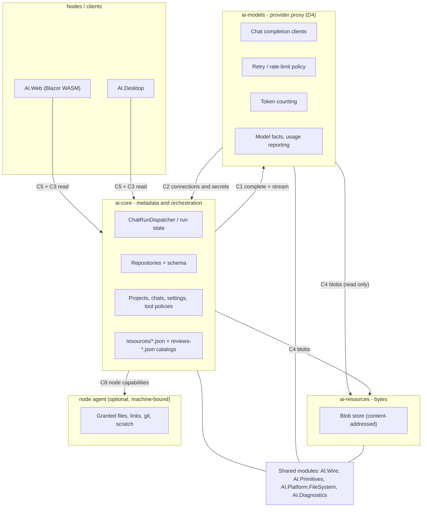
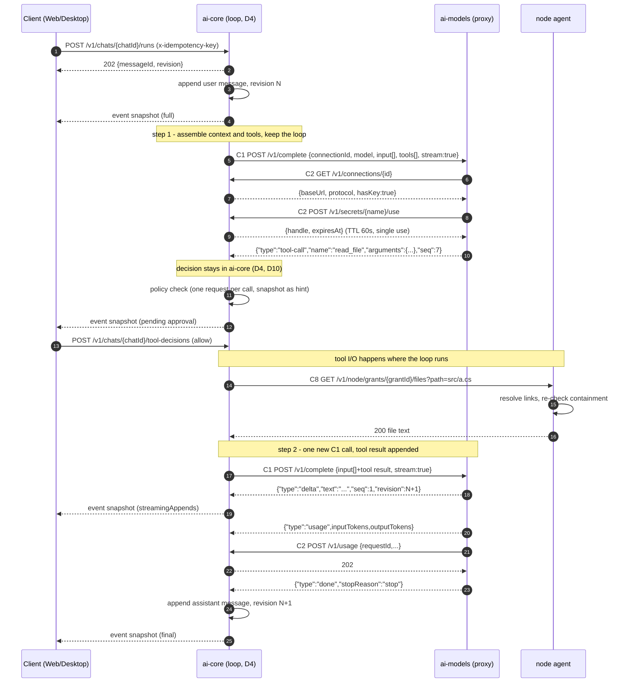
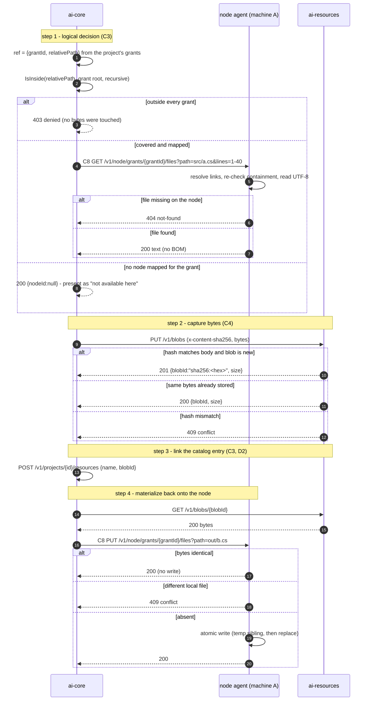

# 04 — Shared parts and component contracts (`S4`, `C1`–`C8`)

Owner: Dan · Contracts. Phase Ф2 of the charter.
Status: **Contracts frozen after Lead decisions D4–D13** (`C1`–`C8`); §4 inventory and §5 boundary are
frozen for the seams `S1`–`S5` plus `S4-node`. §7 records the Lead's answer next to every question
formerly opened here.

Every statement about the current state carries a `path:line` reference to the source.
Statements that come from `docs/` rather than from code are marked as such; unverified reasoning is
marked `assumption:` and external facts are marked `external:`.

## 1. Scope

**In scope**

- `S4` — inventory of the parts of today's code that are shared today and must become reusable
  modules: what each one is, where it lives (`path:line`), who consumes it, which module or package
  it should be extracted into, and what blocks the extraction.
- `C1`–`C8` — the contract specification between `ai-core`, `ai-models`, `ai-resources` and the
  optional node agent (`C8`, D13): operations, request/response formats, error codes, idempotency,
  retries, event ordering and edge cases as "input → output".
- The three Pure.DI compositions that must be cut: `AI.Contracts`, `AI.Server`, `AI.Web`.
- Divergences between the charter's contract text and the code, collected in §7 without editing the
  charter.

**Out of scope**

- The detailed current state of each area. That is Ada (`S1`), Bo (`S2`) and Cleo (`S3`); their
  conclusions are input here, not repeated.
- The final decomposition, deployment topology and migration path — the Lead's
  `05-target-design.md`.
- Any change under `src/`, `tests/`, `build/`. This document is analysis only.

## 2. Current structure: what defines the boundary today

The monolith already has a formal process boundary, but only one: Host ↔ Web/Desktop over HTTP.
There is a version constant and a fixed address, and the whole product's HTTP surface is declared by
endpoint modules.

| Thing | Where | What it actually is today |
| --- | --- | --- |
| Wire version + fixed addresses | `src/AI.Contracts/HostProtocol.cs:5-12` | `ApiVersion = 1`, `PublicHostAddress = "http://127.0.0.1:52173/"`, `PublicWebOrigin = "https://ai.dev-team.org"`. A constant, not a negotiation. |
| Endpoint modules | `src/AI.Server/Hosting/Endpoints/IEndpointModule.cs:9-12` | "Modules hold no services of their own: handlers take what they need as parameters." The route set is described as *the* Host-Web contract that "must not drift". |
| HTTP surface count | `src/AI.Server/Hosting/Endpoints/ChatEndpoints.cs:22-281` | 40 route registrations in one module alone (chat, resources, reviews, assets, archive, undo). |
| Readiness | `src/AI.Server/Hosting/Endpoints/HealthEndpoints.cs:12-21` | One endpoint: `GET /api/health` returning `{ProductName, Version, ApiVersion, Status = "ready"}`. There is no separate liveness/readiness and no component identity. |
| Push channel | `src/AI.Server/Hosting/Endpoints/RunEndpoints.cs:56-70`, `src/AI.Server/Hosting/RunEventsPublisher.cs:18-22` | `GET /api/runs/events` is `text/event-stream`, started with explicit headers so a client learns the Host is up before the first event. |
| Pull channel | `src/AI.Server/Hosting/Endpoints/RunEndpoints.cs:42` | `GET /api/runs` returns the full snapshot list — the cold-start path that the SSE stream then updates. |
| Error shape | `src/AI.Server/Hosting/ApiExceptionHandler.cs:6` | One handler translates exceptions per request; there is no component-neutral error envelope with a machine-readable code. |
| File-system window | `src/AI.Server/Hosting/Endpoints/FileSystemEndpoints.cs:14-27` | `GET /api/filesystem/roots`, `/directories`, `/resolve`. Its own doc comment calls it "a read-only window onto the local file system for anyone who can reach the API — today only the origins in `Cors:AllowedOrigins`, all of them loopback", switchable off with `ServerOptions.BrowseEnabled`. |

`assumption:` the current loopback-only trust model is what makes `/api/filesystem/*` acceptable;
the moment components move to different machines that assumption is gone, which is why `C6` has to
carry an authentication rule — decided by **D5** (see §7, Q7).

## 3. Data and formats that cross a future boundary

| Format | Definition | Crossing today |
| --- | --- | --- |
| Run snapshot | `src/AI.Contracts/Runs/ChatRunSnapshot.cs:3-23` — status, streaming content, queue, revisions, pending approval/prompt, active tools, workspace changes, draft text, context usage, turn usage | Host → Web, inside the SSE `snapshot` event |
| Message delta | `src/AI.Contracts/Runs/ChatRunSnapshot.cs:30-36` — `ChatMessageDelta(ChatMessageAppend(BaseRevision, Revision, Message))` | Host → Web; each append names the revision it builds on |
| Submit command | `src/AI.Contracts/Runs/SubmitChatMessageRequest.cs:8-19` — `OperationId, MessageId, Content, Mode (Send\|Queue\|Fork\|Replace\|SendNow\|Aside), BranchId, ParentMode, ...` | Web/Desktop → Host; becomes `C5` |
| Chat document | `src/AI.Contracts/Chats/ChatDetails.cs:5-23` — `Revision`, messages, branches, tool policies, kind state | Host ↔ Web; becomes `C3` |
| Append request | `src/AI.Contracts/Chats/AppendChatMessageRequest.cs:3-18` — carries `Revision` (the optimistic-concurrency token) | Application → repository; becomes `C3` write |
| Project document | `src/AI.Contracts/Projects/ProjectDetails.cs:3-14` — `Revision`, `DirectoryGrants`, `McpServers`, `ToolPolicies` | Host ↔ Web; becomes `C3` |
| Tool result | `src/AI.Contracts/Tools/ToolCallResult.cs:9-15` — content / structured / meta / **model content**, the only part that returns to the model | inside Host today; splits across `C1` and `C5` |
| Tool identity | `src/AI.Server/Infrastructure/Tools/McpToolSession.cs:54-56` — `schemaHash = SHA256(inputSchema + outputSchema)` | tool policy keys; a cross-component identity concern for `C3`/`C5` |
| Blob identity | `src/AI.Server/Infrastructure/Storage/ResourceAssetService.cs:54` — `assetId = SHA256(bytes ‖ mediaType)` hex, lower case | Host-local path names today; becomes `C4`, where D6 fixes `blobId = sha256(bytes)` and turns media type into blob metadata |

`assumption:` the charter's `sha256:<hex>` blob id and today's chat-asset `assetId` agree about the hash
algorithm but **not** about the hashed input: today's `assetId` is `SHA256(bytes ‖ mediaType)`, not
`SHA256(bytes)`. **D6 decides this**: the media type leaves the hash, a `sha256(bytes)` blob may be empty,
and one migration pass must re-hash every existing asset and rewrite every stored reference to the old
`assetId` (chat resources, undo manifests, review attachments). The undo blobs already address
`sha256(bytes)` ([`ResourceAssetService.cs:133-134`](file:///C:/Projects/DevTeam/AI.Client/src/AI.Server/Infrastructure/Storage/ResourceAssetService.cs#L133)) and therefore converge on the target scheme unchanged. See §6, `C4`.

## 4. Inventory of shared parts (`S4`)

Format: what it is · where it lives today · consumers · proposed module · what blocks extraction.

### 4.1 Shared parts that already have a boundary

| # | Part | Today (`path:line`) | Consumers | Proposed module / package | What blocks extraction |
| --- | --- | --- | --- | --- | --- |
| 1 | **File-system contract**: `IFileSystem`, `IPath`, `IAtomicFileWriter` + `SystemFileSystem`/`SystemPath`/`AtomicFileWriter`, plus `DirectoryEntry`, `FileReadOptions`, `FileEnumerationOptions` | [`IFileSystem.cs:32-93`](file:///C:/Projects/DevTeam/AI.Client/src/AI.Contracts/FileSystem/IFileSystem.cs#L32), [`IPath.cs:56-69`](file:///C:/Projects/DevTeam/AI.Client/src/AI.Contracts/FileSystem/IPath.cs#L56), [`IAtomicFileWriter.cs:19`](file:///C:/Projects/DevTeam/AI.Client/src/AI.Contracts/FileSystem/IAtomicFileWriter.cs#L19) | `ai-core` repositories, the node agent (assets, previews, undo blobs), the logger, tests | `AI.Platform.FileSystem` — contract + one platform adapter | Bound once in the contracts composition ([`Composition.cs:36`](file:///C:/Projects/DevTeam/AI.Client/src/AI.Contracts/Composition.cs#L36)); no interface is *owned* by it. `ResolveLinkTargetAsync` is documented as synchronously completed and is bridged by blocking ([`ProjectPathAccess.cs:17-19`](file:///C:/Projects/DevTeam/AI.Client/src/AI.Server/Application/Resources/ProjectPathAccess.cs#L17)). **D8 freezes this**: the promise survives only *inside* the node, as a documented property of the platform adapter; no caller resolves a link itself any more, the agent performs the containment check and answers `403 denied`, and the blocking bridge disappears with the duty. Under D1 this contract belongs to the **node agent**, not to `C4`. | |
| 2 | **DTO contracts `AI.Contracts`** (Chat, Chats, Projects, Resources, Runs, Settings, Skills, Tools, Usage, Workspace, Schedules, Memory, Instructions, Navigation, Git, Updates, FileSystem) | [`AI.Contracts/`](file:///C:/Projects/DevTeam/AI.Client/src/AI.Contracts) | Host, Web, Desktop, tests | split into `AI.Contracts.Core` (metadata DTOs), `AI.Contracts.Models` (model-facing), `AI.Contracts.Resources` (bytes), `AI.Contracts.Wire` (envelope) | One assembly holds three future components' DTOs; no assembly-level rule today prevents a bytes DTO from referencing a model DTO. Extraction is mechanical but must be decided per DTO (`assumption:` ~140 files). |
| 3 | **Tool presentation adapters + codecs** | [`Composition.cs:37-48`](file:///C:/Projects/DevTeam/AI.Client/src/AI.Contracts/Composition.cs#L37) | Web rendering of tool calls, Host-side result projection | `AI.Contracts.Tools` presentation package | Adapters are registered in the *contracts* composition, so every consumer links them; two of them (`ToolResultCodec`, `ToolResultModelProjector`) belong to the model side, the rest to presentation. The split is per-type, not per-assembly. |
| 4 | **Connection context limits + tool default decision + schedule calendar/descriptions + unified diff + team roster** | [`Composition.cs:49-51`](file:///C:/Projects/DevTeam/AI.Client/src/AI.Contracts/Composition.cs#L49) | Web widgets, Host policy, both | `AI.Contracts.*` pure-calculation packages | These are pure functions sharing one `Transient<...>()` call; splitting them is easy, but each is depended on by both sides of the future boundary, so both components link them. |
| 5 | **Host protocol constant** | [`HostProtocol.cs`](file:///C:/Projects/DevTeam/AI.Client/src/AI.Contracts/HostProtocol.cs) | Host, Web, Desktop | `AI.Contracts.Wire` | Hard-coded port and origin are one-machine facts. `C6` replaces them with environment-provided endpoints; the constant must survive as the **local/loopback default only**. |

### 4.2 Shared parts that are *not* isolated today

| # | Part | Today (`path:line`) | Consumers | Proposed module / package | What blocks extraction |
| --- | --- | --- | --- | --- | --- |
| 6 | **Request/error envelope and HTTP shell** | [`IEndpointModule.cs`](file:///C:/Projects/DevTeam/AI.Client/src/AI.Server/Hosting/Endpoints/IEndpointModule.cs), [`ApiExceptionHandler.cs:6`](file:///C:/Projects/DevTeam/AI.Client/src/AI.Server/Hosting/ApiExceptionHandler.cs#L6) | every endpoint module | `AI.Wire` (envelope, `error.code`, `x-ai-component`, `x-idempotency-key`) implemented as an ASP.NET middleware + a typed client | Today there is no envelope: handlers return `Results.Ok/NotFound/Conflict/BadRequest` directly (e.g. [`ChatEndpoints.cs:243-257`](file:///C:/Projects/DevTeam/AI.Client/src/AI.Server/Hosting/Endpoints/ChatEndpoints.cs#L243)) and errors are exception-mapped. Codes are ASP.NET status codes, not the charter's six. |
| 7 | **Identity and time**: `IIdGenerator`/`Uuid7IdGenerator`, `IClock`/`SystemClock` | [`IIdGenerator.cs:3-6`](file:///C:/Projects/DevTeam/AI.Client/src/AI.Server/Application/Projects/IIdGenerator.cs#L3), [`IClock.cs:3-6`](file:///C:/Projects/DevTeam/AI.Client/src/AI.Server/Application/Projects/IClock.cs#L3), [`Uuid7IdGenerator.cs:5`](file:///C:/Projects/DevTeam/AI.Client/src/AI.Server/Infrastructure/Projects/Uuid7IdGenerator.cs#L5), [`SystemClock.cs:5`](file:///C:/Projects/DevTeam/AI.Client/src/AI.Server/Infrastructure/Projects/SystemClock.cs#L5) | dispatcher, repositories, usage ledger, every service that mints ids | `AI.Primitives` | They live in **Application.Projects** and **Infrastructure.Projects** — namespaces that say "project", not "platform". `external:` sortability of UUIDv7 across machines requires synchronized clocks with bounded skew. **D9** sets the tolerance at **5 s** (`external:` NTP/domain time), and rules that UUIDv7 remain sortable for display and logs only: run and revision order is decided by the revision number and by the monotonic change counter of D11, never by an id. |
| 8 | **Revision + atomic write + per-chat serialization** | `AsyncGate` ([`AsyncGate.cs:4`](file:///C:/Projects/DevTeam/AI.Client/src/AI.Server/Infrastructure/Storage/AsyncGate.cs#L4)), per-chat semaphore ([`ChatSynchronization.cs:5-16`](file:///C:/Projects/DevTeam/AI.Client/src/AI.Server/Application/Chats/ChatSynchronization.cs#L5)), optimistic revision check ([`JsonChatRepository.cs:17`](file:///C:/Projects/DevTeam/AI.Client/src/AI.Server/Infrastructure/Storage/JsonChatRepository.cs#L17), [`:177`](file:///C:/Projects/DevTeam/AI.Client/src/AI.Server/Infrastructure/Storage/JsonChatRepository.cs#L177)), temp-write-then-move ([`:188`](file:///C:/Projects/DevTeam/AI.Client/src/AI.Server/Infrastructure/Storage/JsonChatRepository.cs#L188)) | 12 repositories (`Json*Repository`, `JsonLinesTokenUsageLedger`, `WorkspaceUndoService`, `SkillCatalog`, `ChatHistoryCheckpointRepository`) | `AI.Storage.Local` as the *implementation* of the `C3` write path | `AsyncGate` is `internal` to `AI.Server.Infrastructure.Storage` and is copied per repository by construction; the in-process gate is the only thing making read-modify-write safe. Once `ai-core` runs beside other processes its **only** correct concurrency primitive is the revision compare, which already exists — so the design must keep `If-Match` semantics and treat the local gate as an optimization. **D7** settles it: **one writer** — exactly one `ai-core` process per metadata directory in phase 1, stated explicitly by `C3`/`C6`; `If-Match` is the only authoritative concurrency mechanism, the in-process gate is an optimization the contract does not rely on, and two `ai-core` instances on one directory are an unsupported mode. |
| 9 | **Data-directory lock** | [`DataDirectoryLock.cs:20-30`](file:///C:/Projects/DevTeam/AI.Client/src/AI.Server/Infrastructure/Storage/DataDirectoryLock.cs#L20) — `<data>/.lock`, `FileShare.None`, `DataDirectoryInUseException` | Host startup | stays in `ai-core` (the only component holding the metadata directory) | It is a **cross-process, per-machine** guarantee. Components on different machines cannot share it; **D7** makes the second `ai-core` on one metadata directory an **unsupported mode**: one process per directory in phase 1, and across machines the lock cannot help, so the single-writer rule is what `C3`/`C6` state. |
| 10 | **JSON serialization and document schema versions** | `ProjectDocumentSerializer`, `ChatDocumentSerializer`, `Paths.GetChatSummaryPath`, `HasCurrentManifest` migration ([`JsonChatRepository.cs:35-72`](file:///C:/Projects/DevTeam/AI.Client/src/AI.Server/Infrastructure/Storage/JsonChatRepository.cs#L35)) | all repositories | `AI.Storage.Schema` (serializers + version) | Schema evolution is implicit: a stale summary is migrated on read, and there is **one** reader/writer. Split across components and the schema version becomes a wire concern for `C3`. |
| 11 | **Token usage and cost accounting** | [`ITokenUsageLedger.cs`](file:///C:/Projects/DevTeam/AI.Client/src/AI.Server/Application/Usage/ITokenUsageLedger.cs), `JsonLinesTokenUsageLedger` ([`:28`](file:///C:/Projects/DevTeam/AI.Client/src/AI.Server/Infrastructure/Storage/JsonLinesTokenUsageLedger.cs#L28)), `TokenUsageMeter`, `UsageCostEstimator`, `ConnectionRateLimits` ([composition](file:///C:/Projects/DevTeam/AI.Client/src/AI.Server/Composition.cs#L75)) | dispatcher, Web usage widget | split: metering at `ai-models`, ledger storage in `ai-core` | Today the meter wraps the model client **in the same process** ([composition](file:///C:/Projects/DevTeam/AI.Client/src/AI.Server/Composition.cs#L157): `MeteringChatCompletionClient(new RetryingChatCompletionClient(...))`). Across a process boundary the metering has to be either sent by `ai-models` in the `usage` event (`C1`) or duplicated by the caller. |
| 12 | **Tool policy and decisions** | `ToolPolicyResolver`, `ToolAutoApprover`, `ToolDefaultDecision`, policy stored on project/chat/global ([`ChatRunDispatcher.DecideToolAsync`](file:///C:/Projects/DevTeam/AI.Client/src/AI.Server/Application/Runs/ChatRunDispatcher.cs#L1265)) | dispatcher, settings UI | policy resolution in `ai-core` (it owns projects/chats/settings) | Resolution reads three scopes and is invoked **inside the run loop** while a call waits ([`ApproveAsync`](file:///C:/Projects/DevTeam/AI.Client/src/AI.Server/Application/Runs/ChatRunDispatcher.cs#L1317), re-checking every 2 s). Crossing a process per approval is acceptable; **D10** resolves the latency question: **one decision request per tool call**, plus one policy snapshot per run serving as a cache hint. Re-reading the policy while a card waits (every 2 s today) remains an explicit requirement: granting a tool in settings must unblock the waiting call. |
| 13 | **Logging** | `JsonLineFileLoggerProvider` ([`:8`](file:///C:/Projects/DevTeam/AI.Client/src/AI.Server/Infrastructure/Logging/JsonLineFileLoggerProvider.cs#L8)) | Host | `AI.Diagnostics` | Writes JSON lines through `IFileSystem` to the data directory — i.e. it depends on the metadata root. Each component must log to its own root; sharing one log file across machines is not possible. |
| 14 | **Change/navigation signals** | `AppDataChangeSignal` ([`:7-30`](file:///C:/Projects/DevTeam/AI.Client/src/AI.Server/Application/Notifications/AppDataChangeSignal.cs#L7)) — in-process `Channel<long>` with drop-oldest; `AppNavigationSignal` | `RunEventsPublisher`, every mutating service | split: in-process fan-out per component + a wire subscription for the UI | A `long` version counter incremented in one process means nothing to another component. The signal's contract is "something changed, re-read", which survives as a wire event, and **D11** fixes its owner: the monotonic change counter belongs to `ai-core` and is carried in `data-changed`; no other component invents one. |
| 15 | **SSE publishing of run events** | [`RunEventsPublisher.cs:18-70`](file:///C:/Projects/DevTeam/AI.Client/src/AI.Server/Hosting/RunEventsPublisher.cs#L18) — three producers into one channel, `snapshot`/`data-changed`/`navigate`, 250 ms burst damping ([`:55`](file:///C:/Projects/DevTeam/AI.Client/src/AI.Server/Hosting/RunEventsPublisher.cs#L55)) | Web, Desktop | `ai-core` keeps the publisher; under **D4** the loop also runs there, so no run state has to be streamed in from another component | Today the publisher can read `ChatRunSnapshot` from the dispatcher directly. That stays valid because the loop stays in `ai-core` (D4); the damping/merge logic (`IsStreamingAppend`, draft appends, sent-message suppression) keeps working on local object identity, which is a second reason not to push the loop into `ai-models`. |
| 16 | **Transport resilience** | [`RetryingChatCompletionClient.cs:35`](file:///C:/Projects/DevTeam/AI.Client/src/AI.Server/Infrastructure/Chat/RetryingChatCompletionClient.cs#L35), `ChatTransportPolicy`, `ChatTransportActivity` | model client chain | `ai-models` (it is the component that owns provider failure) | The retry ceiling (`MaxServerFaults = 5`), rate-limit-forever policy and "only a stream that has yielded nothing may restart" rule are *inside* `ai-models` after the split. The caller's `C1` contract must therefore state what `ai-models` reports when it gives up (`C7`), instead of the caller retrying blindly. |
| 17 | **Run event bus / dispatcher** | [`ChatRunDispatcher.cs:159`](file:///C:/Projects/DevTeam/AI.Client/src/AI.Server/Application/Runs/ChatRunDispatcher.cs#L159) `SubmitCoreAsync`, [`GetSnapshotAsync:128`](file:///C:/Projects/DevTeam/AI.Client/src/AI.Server/Application/Runs/ChatRunDispatcher.cs#L128), `SubscribeAsync` [`:139`](file:///C:/Projects/DevTeam/AI.Client/src/AI.Server/Application/Runs/ChatRunDispatcher.cs#L139), plus `ChatRunHostedService` recovery | Web, Desktop, scheduler, skills | **stays in `ai-core`** (charter `C7`: `ai-core` is the source of truth for runs; **D4** keeps the loop here too) | The dispatcher currently does everything in one object: chat lock, queue, model call, tool approval, workspace tracking, message persistence. Under D4 it keeps all of it except the provider call itself, which becomes `POST /v1/complete`; the callbacks handed to the agent ([`agent.RunAsync(...)`](file:///C:/Projects/DevTeam/AI.Client/src/AI.Server/Application/Runs/ChatRunDispatcher.cs#L700)) stay local, and only the model step crosses the boundary. |
| 18 | **Idempotency registry (`Operations`)** | [`ChatRunDispatcher.cs:192`](file:///C:/Projects/DevTeam/AI.Client/src/AI.Server/Application/Runs/ChatRunDispatcher.cs#L192), [`:581`](file:///C:/Projects/DevTeam/AI.Client/src/AI.Server/Application/Runs/ChatRunDispatcher.cs#L581), [`:1561`](file:///C:/Projects/DevTeam/AI.Client/src/AI.Server/Application/Runs/ChatRunDispatcher.cs#L1561) | every command endpoint that accepts `operationId` | `ai-core`, exposed as `x-idempotency-key` (`C5`) | Today the registry is persisted inside the run state document and doubles as "have I already interrupted this". Its failure semantics are visible: same id + different content → `ArgumentException` ([`:195-L197`](file:///C:/Projects/DevTeam/AI.Client/src/AI.Server/Application/Runs/ChatRunDispatcher.cs#L195)), which the HTTP layer turns into a 500 unless mapped. `C5` fixes 409; the code path needs an explicit conflict. |
| 19 | **Pure.DI compositions to cut** | contracts ([`Composition.cs:23-51`](file:///C:/Projects/DevTeam/AI.Client/src/AI.Contracts/Composition.cs#L23)), server shared ([`Composition.cs:40-167`](file:///C:/Projects/DevTeam/AI.Client/src/AI.Server/Composition.cs#L40)), ASP.NET roots ([`:170-225`](file:///C:/Projects/DevTeam/AI.Client/src/AI.Server/Composition.cs#L170)), Web ([`Composition.cs:35-120`](file:///C:/Projects/DevTeam/AI.Client/src/AI.Web/Composition.cs#L35)) | Host, Web, Desktop, tests | one setup per component: `ai-core`, `ai-models`, node agent, plus the existing contracts setup | The contracts setup publishes `IFileSystem`/`IPath`/`IAtomicFileWriter` for everyone and the doc comment warns that re-binding them is an override that Pure.DI rejects with `DIW000`. So the file-system contract is **not divisible today**: whichever component "owns" it, the others must link its setup, which couples every component's DI graph to one shared setup name. Also `Hint.ThreadSafe, "Off"` is set for Web ([`:43`](file:///C:/Projects/DevTeam/AI.Client/src/AI.Web/Composition.cs#L43)) and desktop startup, and the server keeps thread safety — a per-component decision once servers are separate. |
| 20 | **Run-scoped temp directories** | `ToolRunContext`, `TempDirectoryAllocator`/run temp paths ([`Composition.cs`](file:///C:/Projects/DevTeam/AI.Client/src/AI.Server/Composition.cs) registration of tool sessions), used by MCP stdio servers and the C# runner | `ai-core` tool sessions (D4), C# tool server | node agent (local scratch space) | Per D1 the temp directory is a **node** capability, not a bytes contract: it is a filesystem path another process launches from, and it cannot be expressed as `sha256` bytes. It is also never part of a project grant. |

### 4.3 Ownership that must be stated explicitly (D1, D2)

The Lead's D1/D2 decisions move three things that currently have no owner. Recorded here so they do not
become "nobody's":

| Thing | Owner after the split | Why |
| --- | --- | --- |
| **Grant decision** (may this project read logical path X?) — project-relative, logical | `ai-core` (`C3`) | Grants are project metadata ([`ProjectDetails.DirectoryGrants`](file:///C:/Projects/DevTeam/AI.Client/src/AI.Contracts/Projects/ProjectDetails.cs#L3)). A check expressed as `IsInside(candidate, root, recursive)` ([`ProjectPathAccess.cs:24-36`](file:///C:/Projects/DevTeam/AI.Client/src/AI.Server/Application/Resources/ProjectPathAccess.cs#L24)) is logical; the physical root is a fact of one machine. |
| **Physical mapping** (logical root → local directory) and every filesystem-bound capability | node agent (`S4-node`, see §4.4) | Only the machine that owns the directory can resolve links, walk it, run `git diff` there or allocate scratch space. |
| **Blob bytes and their addressing** | `ai-resources` (`C4`) | Content-addressed store; `C4` never speaks project paths. |
| **`resources/<projectId>.json` and `reviews-<projectId>.json`** | `ai-core` metadata (`C3`) | They are per-project catalogs today ([`JsonResourceRepository.cs:11`](file:///C:/Projects/DevTeam/AI.Client/src/AI.Server/Infrastructure/Storage/JsonResourceRepository.cs#L11), [`JsonReviewRepository.cs:11`](file:///C:/Projects/DevTeam/AI.Client/src/AI.Server/Infrastructure/Storage/JsonReviewRepository.cs#L11)); the bytes they point at move to `ai-resources`, the catalogs stay with the rest of the metadata. They must not be re-homed into `ai-resources` just because they are named after resources. **D6/Bo's finding**: the review catalog today also stores the diff bodies themselves — `ChatReview.SourceChanges` holds a whole `WorkspaceChangeSet` ([`ChatReview.cs:9`](file:///C:/Projects/DevTeam/AI.Client/src/AI.Contracts/Resources/ChatReview.cs#L9)) — so after the split the catalog keeps the metadata and the `blobId`, and the diff bodies become `C4` blobs. |

Consequence for addressing (D1): a logical resource reference is either
`{"grantId":"<uuid7>","relativePath":"src/a.cs"}` — resolved to bytes by the node agent that owns `grantId` —
or `{"blobId":"sha256:<hex>"}` for content that has already been captured. Both forms are **metadata**
and belong to `C3`/`S4`, never to `C4`. `C4` sees only the second form, re-encoded as a blob id.

### 4.4 The optional node agent seam (`S4-node`, contract `C8`)

Per D1, everything that is bound to a particular machine goes behind one optional seam. It is a seam,
not a component of the three-component map: it is deployed next to whatever needs local capabilities
(the user's machine in the desktop case, the machine that hosts a project's directory in the server
case).

| Capability today | Where | Node-agent operation |
| --- | --- | --- |
| Grant roots and directory listing | [`FileSystemEndpoints.cs:14-27`](file:///C:/Projects/DevTeam/AI.Client/src/AI.Server/Hosting/Endpoints/FileSystemEndpoints.cs#L14) `/api/filesystem/roots|directories|resolve` | `GET /v1/node/grants`, `GET /v1/node/grants/{grantId}/entries?path=` , `GET /v1/node/resolve?path=` |
| Read/write a granted file | `IFileSystem` ([`IFileSystem.cs:60-93`](file:///C:/Projects/DevTeam/AI.Client/src/AI.Contracts/FileSystem/IFileSystem.cs#L60)), `IAtomicFileWriter` ([`:19`](file:///C:/Projects/DevTeam/AI.Client/src/AI.Contracts/FileSystem/IAtomicFileWriter.cs#L19)) | `GET /v1/node/grants/{grantId}/files?path=&lines=`, `PUT` same path (atomic write) |
| Link resolution + containment check | [`ProjectPathAccess.cs:17-36`](file:///C:/Projects/DevTeam/AI.Client/src/AI.Server/Application/Resources/ProjectPathAccess.cs#L17) | internal to the agent; a path outside the grant answers `403 denied` |
| Git status/diff/blame | `Git` contracts in [`AI.Contracts/Git`](file:///C:/Projects/DevTeam/AI.Client/src/AI.Contracts/Git) | `GET /v1/node/git/status|diff?grantId=&path=` |
| Scratch/temp directory for tool sessions | `ToolRunContext`, tool session factories ([`DefaultToolSessionFactory.cs:20`](file:///C:/Projects/DevTeam/AI.Client/src/AI.Server/Infrastructure/Tools/DefaultToolSessionFactory.cs#L20), [`CSharpToolSessionFactory.cs:25`](file:///C:/Projects/DevTeam/AI.Client/src/AI.Server/Infrastructure/Tools/CSharpToolSessionFactory.cs#L25)) | `POST /v1/node/scratch` → `{path, expiresAt}`; `DELETE` releases it |
| Local process launch (stdio MCP server, C# runner) | `ExternalToolSessionFactory` ([`:18`](file:///C:/Projects/DevTeam/AI.Client/src/AI.Server/Infrastructure/Tools/ExternalToolSessionFactory.cs#L18)) | **not** exposed by the agent in phase 1; the launch stays inside the component that owns the tool session, which under D4 is `ai-core` |

Rules for this seam (D5, D8, D13): the seam carries the contract id **`C8`** (D13) — it is a fixed
identifier, not an unnamed appendix of `C4`, so other documents can reference it. Same envelope, same
six error codes and the same `x-ai-component` header as `C1`/`C4`, **plus the authentication of D5**:
per-node bearer token issued at registration over TLS, confirmed by the transport rather than taken
from the body; a missing or wrong token is `401`, an insufficient one `403 denied`, a disagreement
between the transport identity and `trace.actor` is `400 invalid`. There is **no anonymous access to
any operation of the node agent** (D5), because this seam is what exposes a machine's file system.
Link resolution and grant containment happen **inside** the agent (D8): no caller resolves links itself
any more, the agent answers `403 denied` for a path outside the grant. Explicitly **no cloud-readiness
promise**, no `sha256` addressing, and no assumption that the seam is reachable from `ai-core` on
another machine. When it is unreachable, the caller degrades to "this project has no local node
attached" rather than failing the turn.

## 5. Component boundary (target view)

The diagram is the boundary `S4`, not the deployment detail (that is `05-target-design.md`).

Reading of the arrows, in the charter's terms (with D1 applied):

- Clients talk only to `ai-core`; they never address `ai-models`, `ai-resources` or the node agent
directly. That preserves today's single-origin model ([`HostProtocol.PublicWebOrigin`](file:///C:/Projects/DevTeam/AI.Client/src/AI.Contracts/HostProtocol.cs#L11)).
- `ai-core` → `ai-models` is `C1`, and `ai-core` is the side that drives the loop: **D4** keeps the
agent loop, tool sessions, tool decisions, context assembly and compaction policy in `ai-core`.
`ai-models` is a provider proxy — protocol, SSE parsing, retries, limits, transport timeouts, model
facts and the usage report. The variant in which `ai-models` runs the loop was rejected by the Lead.
Consequence: `C1` carries tool definitions and the per-step round-trips, and the node agent for tool
I/O is reached from **`ai-core`** only: `ai-models` never touches a node, because every byte it needs
arrives as a `{blobId, mediaType}` reference served by `C4`.
- `ai-models` → `ai-core` is `C2` (connections, secrets, usage).
- `ai-models` → `ai-resources` is a **new read-only edge** (Ada's `S1` finding, D4): `input[]` carries
image references as `{blobId, mediaType}` and `ai-models` fetches the bytes itself with the models
service's own credentials, which is what removes today's hidden `S1→S3` link
([`OpenAiCompatibleChatCompletionClient.cs:271-274`](file:///C:/Projects/DevTeam/AI.Client/src/AI.Server/Infrastructure/Chat/OpenAiCompatibleChatCompletionClient.cs#L271)). It never writes and never deletes.
- `ai-core` → `ai-resources` carries **bytes only** (D1): no project paths, no grants, no `git`.
- `ai-core` → node agent is the machine-bound seam (`C8`, §4.4). It is optional: when absent, the
project simply has no local directory on that machine. `ai-models` has **no** node edge at all — it
receives content references (`{blobId, mediaType}`) and never a path.
- `ai-resources` deliberately does **not** depend on the node agent, because it must stay able to
run where no project directory exists (cloud/object storage).

## 6. Contract specification (`C1`–`C8`)

Common rules applied below without repeating them:

- Transport: HTTP/1.1 + JSON over TCP. Streaming: `application/x-ndjson`, one JSON event per line;
  SSE permitted in phase 1 where it matches today's snapshots.
- Envelope (request): `{"v":1,"id":"<uuid7>","op":"<operation>","resource":{"kind":"project|chat|run|blob|connection","id":"..."},"payload":{...},"trace":{"projectId":"...","chatId":"...","branchId":"...","actor":"ai-core|ai-models|ai-resources"},"ts":"<ISO-8601 UTC ms>"}`.
- Envelope (error): `{"v":1,"id":"...","ok":false,"error":{"code":"invalid|not-found|conflict|denied|unavailable|internal","message":"...","retryable":true|false}}`.
- `x-ai-component`: the sending component's identity, **confirmed by the transport and not read from
  the body** (D5). A disagreement with `trace.actor` is `400 invalid`; a missing or wrong bearer token
  is `401`; an authenticated peer without the right to the operation is `403 denied`. Every component
  and every node holds a bearer token issued at registration, over TLS; mTLS is the goal and is added
  later without changing the envelope. There is no anonymous access to any operation.
- Ids: UUIDv7 lower case, hyphenated. Main branch id equals chat id. Times UTC ISO-8601 ms. Clocks are
  synchronized within **5 s** (D9); ids stay sortable for display and logs only, order comes from
  revisions and the `ai-core` change counter (D11).
- Every operation is **idempotent by `id`** (the envelope id) where it creates something; where the
  operation mutates an existing resource, idempotency additionally requires the caller-supplied key
  named in that contract.

### C1 — AI models API

**Division of labour (D4).** `ai-models` is a **provider proxy**: protocol and SSE parsing, retries,
rate limits, transport timeouts, model facts, token counting and the usage report. The agent loop,
tool sessions, tool decisions, context assembly and the compaction policy stay in `ai-core`. Therefore:

- `input[]` carries the **already assembled request**, not an intent. Assembling reads metadata
  (instructions, memory, skills, resource excerpts), which belongs to `ai-core` (Ada's `S1` finding);
  only model *facts* travel back from `ai-models` (D4).
- `ChatCompletionRequest` **never** carries `ApiKey`. A secret crosses only as a one-time handle from
  `C2` (TTL ≤ 60 s, single use, reuse → `409 conflict`, the value never appears in a response or a log).
- Images are references: `input[]` carries `{blobId, mediaType}` and `ai-models` fetches the bytes from
  `C4` with its own credentials (§5, the `ai-models → C4` read-only edge).

**Operations**

| Op | Method and path | Request payload | Success |
| --- | --- | --- | --- |
| Complete / stream | `POST /v1/complete` | `{connectionId, model, input[], tools[], stream, requestId}` | `200` — a single JSON body when `stream:false`; an ndjson event stream when `stream:true` |
| Count tokens (D4) | `POST /v1/tokens/count` | `{connectionId, model, texts[]}` | `200 {tokens, exact:true\|false}` — exact where the provider exposes a counter, otherwise an estimate. The assembling side (`ai-core`) needs this *fact*, not a policy |
| Connection capabilities | `GET /v1/connections/{connectionId}/capabilities` | — | `200 {connectionId, model?, protocols[], imageInput, contextWindow?, maxOutput?}` |
| Health | `GET /healthz`, `GET /readyz` | — | see `C6` |

**Event types on the stream** (charter base, extended): `delta`, `tool-call`, `usage`, `done`.
Extension — `preamble`, `context`, `activity`, `transport-wait` — exists because the current run
snapshot carries them ([`ChatRunSnapshot.cs:11-23`](file:///C:/Projects/DevTeam/AI.Client/src/AI.Contracts/Runs/ChatRunSnapshot.cs#L11)):
`DraftContent`/`DraftToolCall` (prose of the step in flight), `Context` (context usage),
`ActiveTools` (tool progress) and `Wait` (rate-limit waiting) have no home in a four-type stream, yet
the UI already renders them ([`RunEventsPublisher.cs:104-118`](file:///C:/Projects/DevTeam/AI.Client/src/AI.Server/Hosting/RunEventsPublisher.cs#L104)).

**Chunk ordering and non-resumption** (Ada's `S1` finding, D4): every event carries `seq`, unique and
increasing within one stream, plus the `revision` it builds on. A consumer ignores any event whose `seq`
is not greater than the one it has already applied. There is **no resumption inside a stream**: after a
break the caller keeps the partial answer it has already received, and the deterministic partial-reply
ids of `C7` make it safe to commit. `ai-models` does not replay events on reconnect.

**Edge cases (input → output)**

| Input | Output |
| --- | --- |
| `connectionId` not known to `ai-core` | `404 not-found` |
| Connection exists, has no stored key | `409 denied` — `ai-models` asks `C2` and `C2` answers `hasKey:false`. The request body never contained a key, so there is nothing to strip |
| Connection disabled in settings | `409 denied`; the current code refuses before calling the provider ([`ChatRunDispatcher` connection choice](file:///C:/Projects/DevTeam/AI.Client/src/AI.Server/Application/Runs/ChatRunDispatcher.cs#L690), `"Choose an enabled connection for this chat."`) |
| Caller cancels mid-stream | one final `{"type":"done","stopReason":"cancelled"}`, then the stream closes. The current code does the same by committing a truncated assistant message ([`CommitPartialAnswerAsync`](file:///C:/Projects/DevTeam/AI.Client/src/AI.Server/Application/Runs/ChatRunDispatcher.cs#L1380)) |
| Model calls a tool with no arguments | `{"type":"tool-call","name":"x","arguments":"{}"}` — never `null`. `McpToolSession` validates arguments as JSON text and canonicalizes before approval ([`ValidateArguments`](file:///C:/Projects/DevTeam/AI.Client/src/AI.Server/Infrastructure/Tools/McpToolSession.cs#L97)), so `"{}"` is the only correct empty form |
| Model returns empty text | `done` and `usage` with no `delta` |
| Provider returns 429 / 503 / 529 | **not** an error to the caller: `ai-models` waits (charter's `C7`; today `RetryingChatCompletionClient` treats these as always retryable) and emits `transport-wait` so the UI keeps showing a run in progress ([`ChatRunSnapshot.Wait`](file:///C:/Projects/DevTeam/AI.Client/src/AI.Contracts/Runs/ChatRunSnapshot.cs#L21)) |
| Provider returns 500/502/504 or no status at all | retried at most 5 times ([`MaxServerFaults`](file:///C:/Projects/DevTeam/AI.Client/src/AI.Server/Infrastructure/Chat/RetryingChatCompletionClient.cs#L35)), then `502 unavailable`, `retryable:true` |
| Provider returns 401/403/400 | `409 denied` or `400 invalid`, `retryable:false` — the current `Delay(error, attempt)` returns `null` for these, i.e. never retried ([same file](file:///C:/Projects/DevTeam/AI.Client/src/AI.Server/Infrastructure/Chat/RetryingChatCompletionClient.cs#L120)) |
| Retry deadline exceeded while rate-limited | `504 unavailable`, `retryable:true`; today `ChatRetryDeadlineExceededException` |
| Failure after the first `delta` | stream ends with `{"type":"error", ...}`, **no** re-delivery of already-emitted deltas; the caller must keep what it received. Today's rule is explicit: only a stream that has yielded nothing may be restarted ([`StreamAsync`](file:///C:/Projects/DevTeam/AI.Client/src/AI.Server/Infrastructure/Chat/RetryingChatCompletionClient.cs#L60)) |
| `input[]` references a blob id | `ai-models` fetches it through `C4` (read-only edge) by content id; an unknown id → `404 not-found` on the *event stream* as `{"type":"error",...}` if the stream already started |
| `input[]` image reference is `{blobId, mediaType}` and `C4` is unreachable | `503 unavailable`, `retryable:true`; the turn fails as a transport failure, not as a bad request. No cached bytes are used |
| `POST /v1/tokens/count` with a provider that has no counter | `200` with `exact:false` and the estimate; never `501`, because the assembling side always needs a number |
| `POST /v1/tokens/count` for an unknown connection | `404 not-found`; for a connection with no key, `409 denied` (same rule as `POST /v1/complete`) |
| Consumer sees an event whose `seq` is not greater than the applied one | ignored, no error (at-least-once delivery, `C7`) |
| Stream breaks and the caller reconnects | `ai-models` does **not** resume or replay; a new `POST /v1/complete` is a new stream with its own `seq`, and the caller keeps the partial answer it already has |
| `tools[]` empty | no `tool-call` events are possible; behaviour identical to today when no MCP server is enabled |

### C2 — models → metadata (connections, secrets, usage)

**Trust (D5).** Every operation here is authenticated: a per-component bearer token issued at
registration, over TLS. `x-ai-component` is **confirmed by the transport**, not taken from the body;
a disagreement with `trace.actor` is `400 invalid`, a missing or wrong token is `401`, an insufficient
one is `403 denied`. mTLS is the goal and is added later without changing the contract's shape.

| Op | Method and path | Request | Response |
| --- | --- | --- | --- |
| Read connection | `GET /v1/connections/{connectionId}` | — | `{id, baseUrl, protocol:"responses"\|"chat-completions", hasKey, imageInput, contextWindow?}` or `404` |
| Issue secret handle | `POST /v1/secrets/{name}/use` | `{purpose, ttlSeconds?}` | `{handle, expiresAt}`, TTL ≤ 60 s |
| Report usage | `POST /v1/usage` | `{requestId, connectionId, model, inputTokens, outputTokens, purpose, at, trace}` | `202` |
| Read tool policy | `POST /v1/tool-decisions` | `{projectId, chatId, branchId, serverId, name, schemaHash}` | `{"decision":"allow"\|"deny"\|"ask","reason":...}` |

**Edge cases**

| Input | Output |
| --- | --- |
| Unknown `connectionId` | `404 not-found` |
| Empty `name` | `400 invalid` |
| Handle used twice | second use → `409 conflict` |
| Handle presented after its TTL | `409 conflict`, `retryable:true` (a new handle can be issued) |
| `POST /v1/usage` repeated for one `requestId` | `202` both times, counters written once; `ai-models` is the only reporter of usage (D4), so `ai-core`'s bookkeeping never counts the same tokens twice |
| Handle expired (TTL passed) | `409 conflict`, `retryable:true` (a new handle can be issued) |
| Secret value is empty string | `409 denied` — the current store deletes a blank secret rather than storing it ([`ProtectedGlobalSecretStore.SetAsync`](file:///C:/Projects/DevTeam/AI.Client/src/AI.Server/Infrastructure/Settings/ProtectedGlobalSecretStore.cs#L26)), so "handed out" and "absent" are the same state |
| Secret never in the response body | invariant: the handle is the only form; `hasKey` is a boolean, matching today's `ExistsAsync` ([`IGlobalSecretStore.cs`](file:///C:/Projects/DevTeam/AI.Client/src/AI.Server/Application/Settings/IGlobalSecretStore.cs#L9)) |
| Usage reported twice for one `requestId` | `202` both times, stored once (idempotent by `requestId`) |
| Missing or invalid bearer token | `401`; an authenticated peer without the right to the operation → `403 denied` (D5). There is no anonymous path |
| Tool policy for a `schemaHash` that no longer matches | `{"decision":"ask"}` — today a changed schema hash means the stored policy no longer applies, which is why policies are keyed by hash ([`McpToolSession`](file:///C:/Projects/DevTeam/AI.Client/src/AI.Server/Infrastructure/Tools/McpToolSession.cs#L54)) |
| `ai-core` unreachable when a handle is needed | `503 unavailable` from `ai-models`; no cached secret is used. `assumption:` a short-lived handle cache would be a policy change, not an implementation detail |

### C3 — Metadata API

`ai-core` owns all metadata, including the grant decision and the two small catalogs (D1/D2).

**Single writer (D7).** In phase 1 exactly **one** `ai-core` process serves a metadata directory. The
directory lock keeps its meaning, `If-Match` is the **only** authoritative concurrency mechanism, and
the in-process gate is an optimization the contract does not rely on. Two `ai-core` instances on one
directory are an **unsupported mode**, not a degraded one. Cross-machine writers are excluded for the
same reason: the lock is per machine, so the single-writer rule is what makes the revision check
sufficient.

**Trust (D5).** Same rule as `C2`: per-component bearer token over TLS, `x-ai-component` confirmed by
the transport, `400 invalid` on a mismatch with `trace.actor`, `401` without a valid token, `403 denied`
when the peer is authenticated but not entitled. No anonymous access.

**Operations**

| Op | Method and path | Notes |
| --- | --- | --- |
| Get project | `GET /v1/projects/{id}` | document or `404` |
| List projects | `GET /v1/projects?limit=100&cursor=` | `{items, nextCursor}`; `limit > 1000` → `400` |
| Get chat | `GET /v1/chats/{chatId}` | includes branches, messages, policy fields; `404` when absent |
| Append message | `POST /v1/chats/{chatId}/messages` | `{messageId, parentId, role, content, branchId, ...}` → `{revision}` |
| Update chat / project | `PUT /v1/chats/{chatId}`, `PUT /v1/projects/{id}` | requires `If-Match: <revision>` |
| Delete | `DELETE /v1/chats/{chatId}?revision=` | today's delete carries the revision in the query string ([`ChatEndpoints.cs:281`](file:///C:/Projects/DevTeam/AI.Client/src/AI.Server/Hosting/Endpoints/ChatEndpoints.cs#L281)) |
| Read message content | `GET /v1/chats/{chatId}/messages/{messageId}/content` | tool output may be omitted from the list and fetched here ([`ChatRunDispatcher.TrackMessage`](file:///C:/Projects/DevTeam/AI.Client/src/AI.Server/Application/Runs/ChatRunDispatcher.cs#L1180): `ContentOmitted = true`) |
| **Resolve a logical resource reference** (D1) | `POST /v1/resources/resolve` | `{projectId, ref:{grantId, relativePath} \| {blobId}}` → `{grantId, nodeId?, physicalRoot?, blobId?}`. This is the *decision* half: does the project's grant cover the path, and which node owns that grant. A `denied` decision here is `403`, before any bytes are touched |
| **Grant catalog** (D1) | `GET /v1/projects/{id}/grants`, `PUT /v1/projects/{id}/grants/{grantId}` | the logical grants of a project, project-relative; the physical mapping of a grant is registered by the node agent (see §4.4) and is **not** stored here |
| **Resource catalog** (D2) | `GET /v1/projects/{id}/resources`, `POST /v1/projects/{id}/resources` | the `resources/<projectId>.json` catalog: asset metadata plus `blobId`. Never the bytes |
| **Review catalog** (D2) | `GET /v1/projects/{id}/reviews`, `POST …/reviews` | the `reviews-<projectId>.json` catalog: review entries, their comments and the `blobId` of the diff/attachment bytes. **Never the diff bodies.** Today the catalog stores the whole change set in `ChatReview.SourceChanges` ([`ChatReview.cs:9`](file:///C:/Projects/DevTeam/AI.Client/src/AI.Contracts/Resources/ChatReview.cs#L9)); after the split that field holds a `blobId` and the bytes live in `C4` |

**Edge cases**

| Input | Output |
| --- | --- |
| `PUT` without `If-Match` | `428` (charter). Today the equivalent is a `revision` query parameter or a `Revision` field in the body ([`AppendChatMessageRequest.cs:7`](file:///C:/Projects/DevTeam/AI.Client/src/AI.Contracts/Chats/AppendChatMessageRequest.cs#L7)) |
| `PUT` with `If-Match` older than current | `409 conflict` + `{currentRevision}`. Today `JsonChatRepository.SaveAsync` returns `ChatSaveResult.Conflict(revision)` ([`:177`](file:///C:/Projects/DevTeam/AI.Client/src/AI.Server/Infrastructure/Storage/JsonChatRepository.cs#L177)) and the endpoint answers `Results.Conflict(...)` |
| `POST` message with an existing `messageId` and identical content | `200` with the **same** revision; the current dispatcher returns the stored snapshot for a repeated `operationId` ([`:192-197`](file:///C:/Projects/DevTeam/AI.Client/src/AI.Server/Application/Runs/ChatRunDispatcher.cs#L192)) |
| `POST` message with an existing `messageId`, different content | `409 conflict`. Today: `ArgumentException("This message id is already used in the chat...")` ([`:200-202`](file:///C:/Projects/DevTeam/AI.Client/src/AI.Server/Application/Runs/ChatRunDispatcher.cs#L200)) — a 400/500 today, a 409 under this contract |
| Same `operationId`, different payload | `409 conflict` (charter `C5`); today `ArgumentException` ([`:193-194`](file:///C:/Projects/DevTeam/AI.Client/src/AI.Server/Application/Runs/ChatRunDispatcher.cs#L193)) |
| Nonexistent or foreign id | `404`, never `403` (charter) |
| Malformed id | `400 invalid` |
| Append to a chat whose branch was deleted meanwhile | `409 conflict`; the current code raises `RunDispatchException(RunFailureKind.BranchDeleted, ...)` ([`ResolveParent`](file:///C:/Projects/DevTeam/AI.Client/src/AI.Server/Application/Runs/ChatRunDispatcher.cs#L1230)) and the run stops rather than the branch being recreated |
| Concurrent appends to the same chat from two callers | exactly one wins by revision; the loser must re-read. In-process this is additionally serialized per chat ([`ChatSynchronization.cs:5-16`](file:///C:/Projects/DevTeam/AI.Client/src/AI.Server/Application/Chats/ChatSynchronization.cs#L5)) — under **D7** the lock is an optimization and the revision check is the contract; there is no second writer to race with, and two `ai-core` processes on the directory are unsupported |
| Pagination cursor from a newer schema | `400 invalid` |
| `resources/resolve` with `ref.relativePath` = `../secrets` or an absolute path | `403 denied` (D1: the logical check happens **before** any node is contacted) |
| `resources/resolve` for a grant that exists but is not mapped on any node | `200 {grantId, nodeId:null}` — the project has no local directory on any attached machine; callers must present this as "not available here", not as an error (`assumption:` this is the honest reading of D1's optional node agent) |
| Registering a resource catalog entry whose `blobId` is unknown to `C4` | `409 conflict` — the catalog must not point at bytes that do not exist. Today the catalog and the bytes live in the same directory, so the case cannot arise |
| Registering a review whose diff bytes are not in `C4` | `409 conflict`, the same rule as for a resource catalog entry: the catalog must not point at bytes that do not exist. The reviewer's workspace change set is uploaded first (`C4`), then the catalog entry is written |
| Deleting a chat while its resources remain | allowed; the resource catalog is per project, not per chat. Today's behaviour deletes chat assets with the chat ([`ResourceAssetService`](file:///C:/Projects/DevTeam/AI.Client/src/AI.Server/Infrastructure/Storage/ResourceAssetService.cs)) — `assumption:` the project-level catalog is the intended owner under D2 |

### C4 — Resources / bytes API (after D1)

**D1 narrows `C4`.** It stores and serves bytes only: no project paths, no grants, no directory walking,
no git, no temp directories. Everything path-shaped moved to the node-agent seam (§4.4), and the
addressing of a *logical* resource is metadata (`C3`). What changes in the charter's text:

- the charter's `GET /v1/workspaces/{projectId}/files?path=…` and `POST /v1/blobs/{blobId}/materialize {projectId, path}`
  are **withdrawn from `C4`**; the first becomes a node-agent read by `grantId`, the second is replaced
  by a byte-returning download plus a node-agent write.
- `blobId = sha256(bytes)` stays exactly as the charter says, and **D6 fixes it as variant A**: the blob
  id is `sha256(bytes)`, the media type is **blob metadata** and no longer part of the hash, and an empty
  blob is allowed (`201`/`200` with `Content-Length: 0`).
- The charter's `403 denied` for "path outside the grant root" now belongs to the node agent; `C4`
  answers `403` only for storage-level policy (e.g. quota).

**Migration step (D6, mandatory).** The change of hash input is not a free rename. Before data moves to
`ai-resources`, one pass must re-hash **every existing asset** as `sha256(bytes)` and rewrite **every
stored reference to the old `assetId`** — chat resources, undo manifests and review attachments. The
undo blobs already address `sha256(bytes)` ([`ResourceAssetService.cs:133-134`](file:///C:/Projects/DevTeam/AI.Client/src/AI.Server/Infrastructure/Storage/ResourceAssetService.cs#L133)),
so they converge on the target scheme without any change; the chat assets hashed as
`SHA256(bytes ‖ mediaType)` ([`:54`](file:///C:/Projects/DevTeam/AI.Client/src/AI.Server/Infrastructure/Storage/ResourceAssetService.cs#L54)) are
the ones that move. Two distinct byte sequences that previously collided only through the media type can
afterwards share one `blobId`, which is the intended semantics, not data loss.

**Trust and single writer (D5, D7).** Same as `C3`: per-component bearer token over TLS, `x-ai-component`
confirmed by the transport, `400 invalid` on a mismatch with `trace.actor`, `401` without a valid token,
`403 denied` when not entitled. No anonymous access. `ai-resources` keeps **no authoritative** catalog of
who references a blob: the referencing catalogs belong to `ai-core` (D2/D7), and this component stays able
to run where no project metadata exists at all.

**Operations**

| Op | Method and path | Notes |
| --- | --- | --- |
| Put blob | `PUT /v1/blobs` with `x-content-sha256` | `201 {blobId:"sha256:<hex>", size, mediaType?}` |
| Get blob | `GET /v1/blobs/{blobId}` (optional `Range`) | `200`/`206`/`404`/`416`; `Content-Type` from stored metadata |
| Blob metadata | `HEAD /v1/blobs/{blobId}` | `200` with `Content-Length`, `x-media-type`, `x-created-at` |
| Delete blob | `DELETE /v1/blobs/{blobId}` | `204`; deleting an absent blob is `204` (idempotent) |
| Upload and link in one step | `POST /v1/blobs?projectId=` | `201` + the `C3` catalog entry created by `ai-core` in the same request (`assumption:` avoids a two-phase write) |
| Health | `GET /healthz`, `GET /readyz` | see `C6` |

**Edge cases**

| Input | Output |
| --- | --- |
| Same content uploaded twice | `200` and the same `blobId`; the current store skips the write when the file exists ([`ResourceAssetService.StoreAsync`](file:///C:/Projects/DevTeam/AI.Client/src/AI.Server/Infrastructure/Storage/ResourceAssetService.cs#L56)) |
| Declared `x-content-sha256` differs from the body | `409 conflict` |
| Empty file (0 bytes) | `200`, `Content-Length: 0`, empty body; the empty blob is a valid blob under D6. **Today this is impossible for chat assets**: `StoreAsync` rejects a zero-length upload (`data.Length is 0 or > MaximumBytes` → `InvalidDataException`, [`:41-42`](file:///C:/Projects/DevTeam/AI.Client/src/AI.Server/Infrastructure/Storage/ResourceAssetService.cs#L41)) |
| Body larger than the limit | `413`; today the ceiling is 15 MB enforced twice — by the endpoint ([`ChatEndpoints.cs:24`](file:///C:/Projects/DevTeam/AI.Client/src/AI.Server/Hosting/Endpoints/ChatEndpoints.cs#L24)) and by the service constant [`:22`](file:///C:/Projects/DevTeam/AI.Client/src/AI.Server/Infrastructure/Storage/ResourceAssetService.cs#L22) |
| `Range` entirely past the end | `416` |
| Unknown `blobId` | `404` |
| Blob id not matching `sha256:<64 hex>` | `400 invalid`; today a length/hex check silently returns `null` ([`:72-73`](file:///C:/Projects/DevTeam/AI.Client/src/AI.Server/Infrastructure/Storage/ResourceAssetService.cs#L72)) |
| Blob bytes fail the integrity re-hash on read | `500 internal` (D12): a mismatch is a storage fault, not a missing file. `404` is reserved for absence, so a corrupt blob is never reported as "absent". Today a mismatch silently becomes "not found" ([`:144-150`](file:///C:/Projects/DevTeam/AI.Client/src/AI.Server/Infrastructure/Storage/ResourceAssetService.cs#L144)) |
| `DELETE` of an unknown blob | `204` (idempotent), not `404` |
| Two concurrent `PUT`s of the same content | both `201`/`200`, one physical write; the store is content-addressed so this is safe |
| Project deleted, bytes remain | bytes stay until `DELETE`; `ai-core` owns the catalog that referenced them (D2). `assumption:` orphan collection is a separate job |
| **Old capability that no longer has a home in `C4`** | the browser ticket flow (`…/assets/{assetId}/ticket`, random 32-byte ticket, 4 h, [`:113-121`](file:///C:/Projects/DevTeam/AI.Client/src/AI.Server/Infrastructure/Storage/ResourceAssetService.cs#L113)) stays in `ai-core` as an *authorization* concern for the browser: the ticket grants access to a blob id through `ai-core`, and `ai-core` fetches the bytes from `C4` with its own credentials. `C4` itself is not exposed to browsers |

### C5 — Chat commands and run events

**Client-facing boundary.** `ai-core` owns this contract; after D4 the loop also lives here, so no run
state has to be streamed in from `ai-models` for the clients to see it.

| Op | Method and path | Notes |
| --- | --- | --- |
| Submit | `POST /v1/chats/{chatId}/runs` + `x-idempotency-key: <operationId>` | `{op:"send\|queue\|fork\|replace\|sendnow\|aside", branchId, content, parentMode, parentMessageId, resources[], intent}` → `202 {messageId, revision}` |
| Continue | `POST /v1/chats/{chatId}/runs/commands` | `{command:"stop\|resume\|read\|skip\|rebase\|clear\|discard\|send-now", messageId?, branchId, operationId}` |
| Decide tool | `POST /v1/chats/{chatId}/tool-decisions` | `{approvalId, action:"allow\|deny\|allow-for-chat\|allow-for-project\|allow-globally"}` |
| Answer prompt | `POST /v1/chats/{chatId}/prompts/answer` | `{promptId, outcome, values[]}` |
| Events | `GET /v1/chats/{chatId}/events?sinceRevision=N&branchId=` | ndjson of run snapshots |
| Snapshot | `GET /v1/runs` | full list, the cold-start path |

**Event ordering and shape**

1. On subscribe, one `{"type":"snapshot","full":true,...}` is sent immediately — matching today's
   first publication from `SubscribeAsync` ([`ChatRunDispatcher.cs:139-152`](file:///C:/Projects/DevTeam/AI.Client/src/AI.Server/Application/Runs/ChatRunDispatcher.cs#L139)).
2. Then incremental `snapshot` events with `changed`, `removed`, `streamingAppends`, `draftAppends`,
   `keptChanges` ([`RunEventsPublisher.cs:92-125`](file:///C:/Projects/DevTeam/AI.Client/src/AI.Server/Hosting/RunEventsPublisher.cs#L92)).
3. `data-changed` events carry only the monotonic change counter of `ai-core` (D11) and mean "re-read
   what you show"; bursts are damped by 250 ms ([`:55`](file:///C:/Projects/DevTeam/AI.Client/src/AI.Server/Hosting/RunEventsPublisher.cs#L55)). No other component invents a counter, and the
   value orders nothing but freshness: run and revision order belongs to the revision number (D9/D11).
4. `navigate` events are not damped, because a client must be able to open a chat it just created
   ([`:62-70`](file:///C:/Projects/DevTeam/AI.Client/src/AI.Server/Hosting/RunEventsPublisher.cs#L62)).

**Edge cases**

| Input | Output |
| --- | --- |
| Repeat submit, same `x-idempotency-key`, same content | `202` with the same `messageId` |
| Repeat submit, same key, different content | `409 conflict` |
| Submit with empty content and no resources | `400 invalid`; today `ArgumentException("A message needs text or a resource reference.")` ([`:163-164`](file:///C:/Projects/DevTeam/AI.Client/src/AI.Server/Application/Runs/ChatRunDispatcher.cs#L163)) |
| `operationId` or `messageId` is `Guid.Empty` | `400 invalid` ([`:165-166`](file:///C:/Projects/DevTeam/AI.Client/src/AI.Server/Application/Runs/ChatRunDispatcher.cs#L165)) |
| `branchId` doesn't exist | `404 not-found`; today `ArgumentException("Branch does not exist.")` |
| `op:"replace"` with `replaceSourceId` not on the branch | `409 conflict`; today `ArgumentException("Replacement message does not belong to the selected branch.")` |
| `op:"fork"` with a teammate name already taken | `409 conflict`; today a name of ≤32 chars and role of ≤48 is enforced and duplicates refused ([`:215-228`](file:///C:/Projects/DevTeam/AI.Client/src/AI.Server/Application/Runs/ChatRunDispatcher.cs#L215)) |
| `sinceRevision` greater than the current revision | `200`, header `x-ai-current-revision`, **no events** — explicitly not an error |
| Client missed revisions (its `N` is below what the stream can bridge) | next event is a full `snapshot` |
| Stop while a submit is unwinding | the submit is ordered after the stop finishes (today: `AwaitStopAsync`) |
| Tool decision for an approval that is no longer pending | `409 conflict`; today `DecideToolAsync` returns `false` → `Results.Conflict()` |
| Tool policy re-read while a card waits | still required (D10): granting a tool in settings must unblock the waiting call. One decision request per tool call, plus one policy snapshot per run kept as a cache hint — the snapshot never replaces the per-call request |
| Prompt answer whose `promptId` is stale | `409 conflict`; today `runtime.PendingPrompt?.Id != response.PromptId` → `false` |
| Run is non-interactive (background/subtask) and a tool needs approval | auto-`deny`, no card ([`ApproveAsync`](file:///C:/Projects/DevTeam/AI.Client/src/AI.Server/Application/Runs/ChatRunDispatcher.cs#L1320)) |
| Chat deleted while events are subscribed | stream closes; `assumption:` the charter does not name a code. The closest existing behaviour is the runtime being removed from `_runtimes` and the snapshot disappearing, which a client currently reads as "gone" |
| `resources[]` entry is `{grantId, relativePath}` (D1) | `ai-core` resolves it via `C3` before starting the run; an unmapped grant on the target node is `409 conflict` with `reason:"no-node"` — the run must not silently start without the attachment |

### C6 — Topology, naming, health, identity

| Item | Contract |
| --- | --- |
| Service names | `ai-models`, `ai-core`, `ai-resources`; the node agent is `ai-node` per machine |
| Ports | from environment: `AI__MODELS__PORT`, `AI__CORE__PORT`, `AI__RESOURCES__PORT`, `AI__NODE__PORT` |
| Peer addresses | `AI__CORE__URL`, `AI__MODELS__URL`, `AI__RESOURCES__URL`, `AI__NODE__URL`; no hard-coded host names |
| Health | `GET /healthz` → `{"status":"ok","component":"ai-core","v":1}` |
| Readiness | `GET /readyz` → `200` when the component can serve; `503` otherwise, with `{"status":"not-ready","reason":"..."}` |
| Local default | `HostProtocol.PublicHostAddress` stays as the loopback default only ([`HostProtocol.cs:9`](file:///C:/Projects/DevTeam/AI.Client/src/AI.Contracts/HostProtocol.cs#L9)) |
| Data-directory lock | only `ai-core` acquires `<data>/.lock`; **one `ai-core` process per metadata directory** (D7), a second is unsupported ([`DataDirectoryLock.cs:20-30`](file:///C:/Projects/DevTeam/AI.Client/src/AI.Server/Infrastructure/Storage/DataDirectoryLock.cs#L20)) |
| Identity header | `x-ai-component` on every request; a mismatch with `trace.actor` → `400 invalid` |
| Wire version | `v` in the envelope; a newer major → `400 invalid` with `message` naming the supported version |
| Node-agent registration (D1) | `POST /v1/node/register {nodeId, grants:[{grantId, physicalRoot}], capabilities[]}`; `ai-core` keeps the mapping. The node agent is the only party that reports physical paths |

**Edge cases**

| Input | Output |
| --- | --- |
| Peer not reachable | `503 unavailable`, `retryable:true`, and the caller degrades rather than crashes |
| `readyz` during metadata migration on startup | `503 not-ready` until the migration finishes (`assumption:` — today `WarmUpAsync` recovers runs before serving, [`:99-127`](file:///C:/Projects/DevTeam/AI.Client/src/AI.Server/Application/Runs/ChatRunDispatcher.cs#L99)) |
| Port variable missing | refuse to start, naming the variable. `assumption:` fail-fast is preferable to a default that silently collides |
| Two `ai-core` instances on one metadata directory | the second fails the lock as today; **D7** makes this an explicitly unsupported mode, and across machines the lock cannot help either |
| Request with `v:2` | `400 invalid` |
| Request with an unknown `op` | `400 invalid` |
| Node agent registered twice for the same `grantId` on different machines | `409 conflict`; a logical grant has exactly one physical mapping at a time. `assumption:` "at a time" allows re-registration after the node reports `offline` |
| Node agent stops heartbeating | after the configured interval the grant is treated as unmapped in `C3`; the run degrades to "no local directory", it does not fail (D1: the node seam is optional) |

### C7 — Delivery semantics

- **At-least-once** between components. `ai-core` is the source of truth for runs; `ai-models`,
  `ai-resources` and the node agent keep no authoritative state (caches with a TTL and a bounded size only).
- **No distributed transactions.** Every cross-component write is idempotent by the key named in its
  contract: `operationId`/`messageId` (`C5`), `requestId` (`C2` usage), `blobId` (`C4`), `If-Match`
  revision (`C3`).
- **Failure of `ai-models` mid-stream** → `ai-core` marks the run `Interrupted` with a
  `RunFailureKind`; a retry reuses the original `messageId` and the deterministic response id.
  Today the deterministic ids already exist: `ReplyId(messageId) = SHA256("assistant:" + messageId)`
  and `PartialReplyId(messageId) = SHA256("assistant-partial:" + messageId)`
  ([`:1360-1370`](file:///C:/Projects/DevTeam/AI.Client/src/AI.Server/Application/Runs/ChatRunDispatcher.cs#L1360)),
  which is exactly what makes "commit the same interrupted attempt twice" produce one message.
- **Ordering**: events within one branch are ordered by run revision; across branches no order is
  promised. Every event carries the revision it builds on so a client can detect a gap.
- **Retry classification**: `retryable:true` for `unavailable`; `false` for `invalid`, `not-found`,
  `denied`, `conflict`; `internal` is `retryable:true` only when it is a final failure of a
  downstream provider that the caller may retry with the same key.

**Edge cases**

| Input | Output |
| --- | --- |
| Duplicate stream event (at-least-once) | the client ignores an event whose revision it already applied |
| `ai-core` restarts mid-run | runs are recovered from the run repository and republished ([`WarmUpAsync`](file:///C:/Projects/DevTeam/AI.Client/src/AI.Server/Application/Runs/ChatRunDispatcher.cs#L99)); a client that reconnects gets a full snapshot |
| `ai-models` restarts mid-stream | the stream breaks; `ai-core` marks the branch interrupted and the reply stays partial — never silently empty |
| Message written twice by the retry | impossible while ids are deterministic: the append path checks for the id first ([`:1242-1250`](file:///C:/Projects/DevTeam/AI.Client/src/AI.Server/Application/Runs/ChatRunDispatcher.cs#L1242)) |
| Blob `PUT` retried after the response was lost | the second attempt matches by content, so it answers `200` with the same `blobId` |
| Clock skew between machines | bounded to 5 s (D9, `external:` NTP/domain); beyond that UUIDv7 ordering degrades for display only, since run and revision order comes from the revision number |

### C8 — Node agent (machine-bound) capabilities

The seam `S4-node` (§4.4) carries the fixed contract id **`C8`** (D13), so other documents can
reference it. It is the only contract that is **not** part of the three-component map: a node agent
is deployed next to a directory and exists per machine, and the seam is optional.

**Division of labour (D1/D8).** `C8` is the owner of everything path-shaped: logical grant → physical
root mapping, directory listing, file read/write, link resolution and grant containment, `git`, and
scratch space. No other component resolves a link, and no caller checks containment itself: a path
outside the grant is answered by the agent as `403 denied` (D8). `ai-resources` deliberately has no
edge here, because it must run where no project directory exists.

**Trust (D5).** Mandatory: a per-node bearer token issued at registration, over TLS, with
`x-ai-component` confirmed by the transport. **No anonymous access to any operation.** A disagreement
with `trace.actor` is `400 invalid`, a missing or wrong token is `401`, an authenticated peer without
the right is `403 denied`. mTLS is a later, shape-preserving step.

| Op | Method and path | Request | Success |
| --- | --- | --- | --- |
| Register a node and its grants | `POST /v1/node/register` | `{nodeId, grants:[{grantId, physicalRoot}], capabilities[]}` | `200`; `ai-core` keeps the mapping (`C6`) |
| List grants | `GET /v1/node/grants` | — | `200 {items:[{grantId, physicalRoot?, capabilities[]}]}` |
| List a directory inside a grant | `GET /v1/node/grants/{grantId}/entries?path=` | — | `200 {items:[{name, kind, size, modifiedAt}]}` |
| Read a file | `GET /v1/node/grants/{grantId}/files?path=&lines=` | — | `200` text (UTF-8, no BOM) or `206` for a line range |
| Write a file | `PUT /v1/node/grants/{grantId}/files?path=` | body = bytes; atomic write | `200` |
| Resolve a link | `GET /v1/node/resolve?path=` | — | `200 {physicalPath}` or `403 denied` |
| Git view | `GET /v1/node/git/status\|diff?grantId=&path=` | — | `200` |
| Scratch space | `POST /v1/node/scratch` / `DELETE /v1/node/scratch/{id}` | — | `200 {path, expiresAt}` / `204` |
| Health | `GET /healthz`, `GET /readyz` | — | see `C6` |

**Edge cases (input → output)**

| Input | Output |
| --- | --- |
| Path outside the grant (`../`, absolute, or through a symlink) | `403 denied`, decided **inside** the agent (D8); no other component may pre-empt or duplicate this check |
| Unknown `grantId` | `404 not-found` |
| File absent on the node | `404 not-found` — note that `IFileSystem` answers `null`/`false` in-process; over the wire absence is a status code |
| Same `grantId` registered by two machines | `409 conflict` (`C6`): a logical grant has exactly one physical mapping at a time |
| Write to a path that already holds different bytes | `409 conflict` unless the caller asked for an overwrite; the agent never silently replaces content it was not told about |
| Local process launch (stdio MCP server, C# runner) | **not exposed** by the agent in phase 1; the launch stays in the component that owns the tool session, which under D4 is `ai-core` |
| Node agent unreachable from `ai-core` | `503 unavailable`, `retryable:true`; the turn degrades to "this project has no local node attached" rather than failing |

## 7. Questions — closed by the Lead (`frozen after Lead decision`)

This section no longer proposes anything: **the Lead decided all ten questions (D4–D13) and the five
questions raised by Ada (`S1`) that touched `C1`/`C2`/`C4`.** The frozen wording is recorded next to
each question, and §6 already carries its consequences. Where a decision rests on a recommendation
rather than on a user's own answer, the Lead marked it an assumption; it can be revisited **without
changing the envelope's shape, only the content of the contract**.

**Q1 — Where does the agent loop live?** (`C1`, `C5`, `C7`) — **decided: D4, the loop stays in
`ai-core`; variant B is rejected.** `ai-models` is a provider proxy: protocol, SSE parsing, retries,
rate limits, transport timeouts, model facts and the usage report. The loop, tool sessions, tool
decisions, context assembly and the compaction policy stay in `ai-core`. `assumption:` the user was
asked and did not answer in time, so the recommended variant was taken; an objection reopens it
without changing the envelope. Consequence: `C1` gains `POST /v1/tokens/count` for the need of the
assembling side, which needs a model *fact* rather than a policy.

**Q2 — Blob identity and migration.** (`C4`) — **decided: D6, variant A.** `blobId = sha256(bytes)`,
media type is blob metadata, an empty blob is allowed (`201`/`200`, `Content-Length: 0`). The migration
step is mandatory and is written out in `C4`: re-hash every existing asset and update every stored
reference to the old `assetId` (chat resources, undo manifests, review attachments) in one pass before
data moves. The undo blobs already address `sha256(bytes)`
([`ResourceAssetService.cs:133-134`](file:///C:/Projects/DevTeam/AI.Client/src/AI.Server/Infrastructure/Storage/ResourceAssetService.cs#L133)) and
converge on the target scheme without any change.

**Q3 — Metadata concurrency across machines.** (`C3`, `C6`) — **decided: D7, yes, a single writer.**
In phase 1 exactly one `ai-core` process per metadata directory, stated explicitly in `C3` and `C6`. The
directory lock keeps its semantics, `If-Match` is the only authoritative concurrency mechanism, and the
in-process gate is an optimization the contract does not rely on. Two `ai-core` instances on one
directory are an unsupported mode.

**Q4 — `ResolveLinkTargetAsync` is synchronously complete.** (`S4`, `C8`) — **decided: D8, the promise
survives, but only inside the node.** `IFileSystem` keeps the documented synchronous-resolution
property as a contract of the platform adapter, while no caller resolves links itself any more: the
node agent performs the containment check and answers `403 denied`. The blocking bridge in
[`ProjectPathAccess.cs:17-19`](file:///C:/Projects/DevTeam/AI.Client/src/AI.Server/Application/Resources/ProjectPathAccess.cs#L17)
disappears together with the duty.

**Q5 — UUIDv7 sortability across machines.** (`C6`) — **decided: D9, a 5-second clock tolerance.**
Component clocks are synchronized within 5 s (`external:` NTP/domain time); UUIDv7 stay sortable for
display and logs, but run and revision order is not derived from them — the revision number and the
monotonic counter of D11 serve that purpose.

**Q6 — Tool policy and approval round-trips.** (`C5`, `C3`) — **decided: D10, one decision request per
tool call**, plus one policy snapshot per run as a cache hint. Re-reading the policy while a card waits
(every 2 s today) remains an explicit requirement: granting a tool in settings must unblock the waiting
call.

**Q7 — Component-to-component trust.** (`C6`, `C8`) — **decided: D5, a bearer token per component and
per node, issued at registration, plus TLS; mTLS is the goal and comes later without a change to the
contract's shape.** `x-ai-component` is confirmed by the transport, not taken from the body: a
disagreement with `trace.actor` is `400 invalid`, a missing or wrong token is `401`, an insufficient one
is `403 denied`. The node agent has no anonymous access to any operation. `assumption:` cheapest working
scheme, since the user did not answer; tightening to mTLS is a separate step.

**Q8 — The change counter.** (`C5`) — **decided: D11, yes.** The monotonic change counter belongs to
`ai-core` and is carried in `data-changed`; no other component invents one.

**Q9 — Corrupt blob vs. absent blob.** (`C4`) — **decided: D12, agreed.** A repeated hash mismatch is
`500 internal`; `404` is only for absence.

**Q10 — Does the node seam need a contract id?** (`S4`, D1) — **decided: D13, yes, `C8` is fixed for
the node edge.** The scheme is extended to `C1`–`C8`, with the seams `S1`–`S5` plus `S4-node`; other
documents reference `C8`.

**From Ada's questions (`S1`) — what the contracts must carry.** All five are folded into §6 and are
not rewritten there as questions:

1. **The assembled prompt, not an intent**: `input[]` in `C1` carries the already assembled request,
   because assembling reads metadata (instructions, memory, skills, resource excerpts) and belongs to
   `ai-core`; only model facts come from `ai-models` (D4).
2. **A secret is a handle only**: `ChatCompletionRequest` never carries `ApiKey`; the handle comes from
   `C2` with TTL ≤ 60 s, single use, reuse → `409 conflict`, and the value appears neither in a response
   nor in a log.
3. **Images are fetched by `ai-models`**: `input[]` carries `{blobId, mediaType}` and the bytes come
   from `C4` under the models service's own credentials. This adds the read-only `ai-models → C4` edge
   to the boundary map (§5) and removes today's hidden `S1→S3` link
   ([`OpenAiCompatibleChatCompletionClient.cs:271-274`](file:///C:/Projects/DevTeam/AI.Client/src/AI.Server/Infrastructure/Chat/OpenAiCompatibleChatCompletionClient.cs#L271)).
4. **Chunk stream**: every event carries `seq` within the stream and the `revision`; a consumer ignores
   an event whose `seq` is not greater than the one it applied; there is no resumption inside a stream,
   and after a break the caller keeps the partial answer it has (deterministic partial-answer ids from
   `C7`).
5. **Who retries, who times out, who writes usage**: transport retries and timeouts (`ChatTransportPolicy`)
   belong to `ai-models` (with `transport-wait` on the stream); the run-level retry belongs to `ai-core`,
   idempotent by `messageId`. Usage is written by `ai-models` through `C2 POST /v1/usage`, idempotent by
   `requestId`; `ai-core`'s bookkeeping does not count the same tokens twice.

**Reviews (Bo's `S2` finding).** The review catalog stores the diff bodies in full
(`ChatReview.SourceChanges` holds a whole `WorkspaceChangeSet`,
[`ChatReview.cs:9`](file:///C:/Projects/DevTeam/AI.Client/src/AI.Contracts/Resources/ChatReview.cs#L9)).
In the `C3` catalog only the metadata and the `blobId` remain; the diff bodies move to `C4` as blobs.
This is reflected in the review-catalog operations of `C3`.

## 8. External dependencies and constraints

- **Platform-bound, cannot be shared across machines**: the data-directory lock
  ([`DataDirectoryLock.cs:23`](file:///C:/Projects/DevTeam/AI.Client/src/AI.Server/Infrastructure/Storage/DataDirectoryLock.cs#L23) uses
  `FileShare.None` / `flock`), and single-instance protection generally.
- **Credential protection is machine-local**: Windows DPAPI, otherwise AES-GCM under a keyring key or
  a key file ([`Composition.cs:84-100`](file:///C:/Projects/DevTeam/AI.Client/src/AI.Server/Composition.cs#L84)). Secrets
  cannot be moved between machines in their stored form — relevant to `C2`: if `ai-core` and
  `ai-models` are on different hosts, the *decrypted* secret must cross the wire in a handle-scoped
  payload, single-use and short-lived.
- **File-system semantics**: `IFileSystem` deliberately models an in-memory implementation
  ([remarks](file:///C:/Projects/DevTeam/AI.Client/src/AI.Contracts/FileSystem/IFileSystem.cs#L3)), which is why
  the node agent can promise `404` where the interface promises absence.
- **JSON schemas have no explicit version today**; the only version-like mechanism is the manifest
  migration on read ([`JsonChatRepository.cs:35-72`](file:///C:/Projects/DevTeam/AI.Client/src/AI.Server/Infrastructure/Storage/JsonChatRepository.cs#L35)).
  `C3` should add a schema version field before the split, not after.
- **Third-party**: `Json.Schema` + `Json.Pointer` validate tool arguments and results
  ([`McpToolSession.cs:97-210`](file:///C:/Projects/DevTeam/AI.Client/src/AI.Server/Infrastructure/Tools/McpToolSession.cs#L97));
  MCP client/server libraries; Pure.DI 2.5.4 pinned with documented workarounds
  ([`docs/30-dependency-injection.md`](file:///C:/Projects/DevTeam/AI.Client/docs/30-dependency-injection.md) — project doc, not code).
- `external:` S3/object storage, cross-machine latency and streaming over a WAN are not verifiable
  from this repository; every claim about them here is marked `assumption:`.
- `external:` object stores do not offer `Range` on a content-addressed id for free and do not make
  `DELETE` idempotent by default — `C4` must implement both itself.

## 9. Risks

| Risk | Why it bites | Mitigation in the contract |
| --- | --- | --- |
| Agent loop split across two processes introduces a per-step round-trip | today a step is a local call with seven callbacks | **closed by D4**: the loop stays in `ai-core`, so only the provider call crosses the boundary; `C1` carries tool definitions and per-step state |
| Metadata write path depends on an in-process lock | `AsyncGate` + per-chat semaphore make the revision check almost unreachable today | **closed by D7**: a single `ai-core` writer per metadata directory, `If-Match` as the authoritative mechanism |
| Idempotency keys are stored in the run document, not in a durable command log | deleting/compacting run state loses "have I seen this operation" | `C7` states `ai-core` as the source of truth; the command registry must be durable and revision-checked |
| Streaming merge logic is identity-based | `RunEventsPublisher` compares snapshot *object references* to detect appends | the remote stream must express appends explicitly (`streamingAppends`, `draftAppends` are already in the contract) |
| Two different blob id formulas | charter `sha256:<hex>`, code `sha256(bytes‖mediaType)` | **closed by D6**: `blobId = sha256(bytes)`, media type in metadata, mandatory re-hash/rename pass before the data move |
| Secrets crossing a machine | DPAPI/keyring is machine-local | `C2` handles only, TTL ≤ 60 s, one use, never in a response body |
| `429` handling differs by component | `ai-models` waits (bounded by its deadline) on rate limits by design | `C7` says rate-limit waiting is invisible to the caller, except as `transport-wait` events; the caller must not add its own timeout below the `ai-models` deadline |
| Health has no component identity | one `GET /api/health` returns a product name | `C6` replaces it; both endpoints must answer during the migration |
| The node agent becomes an unchecked hole into a machine | it exposes arbitrary local directories by design (D1) | **closed by D5**: mandatory bearer token over TLS, no anonymous operation; the agent only serves `grantId`s registered through `C6`, never arbitrary paths |
| Splitting `resources/*.json` from the bytes they point at | the catalog and the blob can now disagree | `C3` answers `409` when a catalog entry names an unknown `blobId` |

## 10. Input for the target design

1. **Q1 is closed (D4): `ai-models` is a completion proxy and the loop stays in `ai-core`.** It
   fixes what `C1` carries (the assembled request plus tool definitions and per-step round-trips) and
   keeps the whole run state, the event damping and the tool decisions on the `ai-core` side.
2. **Extract three shared packages before splitting**, in this order: `AI.Primitives` (id/time),
   `AI.Wire` (envelope, error codes, headers), `AI.Platform.FileSystem` (the three interfaces plus
   the platform adapter). Each is mechanical and each removes a hard dependency on
   `AI.Contracts.Composition`.
3. **Keep `ai-core` the only writer of metadata** for phase 1 — one process per metadata directory
   (D7), `DataDirectoryLock` unchanged, `If-Match` as the only authoritative concurrency contract.
4. **Do not move the repositories into a shared package.** `Json*Repository`, `AsyncGate` and the
   serializers are `ai-core`'s internals; exposing them would recreate the monolith with a network hop.
5. **Keep the run-event stream as the model→client channel** and give it explicit append events
   (`streamingAppends`, `draftAppends`, `keptChanges`) rather than whole snapshots, because the
   publisher already found that re-sending snapshots cost the client more than the text did
   ([`RunEventsPublisher.cs:120-135`](file:///C:/Projects/DevTeam/AI.Client/src/AI.Server/Hosting/RunEventsPublisher.cs#L120)). Under D4 the producer stays in the same process, so the append events remain an optimization rather than a protocol requirement.
6. **Add a schema version to every metadata document** as part of the split, so `C3` can negotiate
   instead of migrating on read.
7. **Implement `C4` as bytes-only from day one** (D1): do not let a project path ever reach it, not
   even temporarily, or the cloud backend will not be droppable in later.
8. **Treat the node agent as optional everywhere in `ai-core`** — every call to it needs a
   "no node here" path, or the three components cannot run without a local machine (D1).
9. **The trust model is decided (D5)**: a bearer token per component and per node over TLS, issued at
   registration, with `x-ai-component` confirmed by the transport; mTLS is a later, shape-preserving
   step. Every component must still serve only the grants registered through `C6` — never an
   arbitrary path.

## 11. Diagrams for the two most important scenarios

Both are protocol views; they show only what crosses a component boundary.

### 11.1 A normal chat turn that calls one tool

Four places where the protocol is not obvious. The tool decision is a **local** decision inside
`ai-core` (D4/D10): `ai-models` reports the call and never resolves policy. The file read goes from
`ai-core` to the node agent, because the loop and therefore the tool execution live in `ai-core`; if
the loop had moved to `ai-models` this arrow would have reversed, which is exactly what D4 settled.
Every step is a **separate** `POST /v1/complete`, so `ai-models` stays stateless and `ai-core` owns
the conversation state and the per-step tool round-trips. `usage` arrives before the final `done` and
is also reported through `C2 POST /v1/usage` by the same service that counted the tokens (D4), so cost
accounting does not depend on the last event and is not counted twice.

### 11.2 Reading and materializing a project file (after D1)

The read path is where the contract deliberately differs from today's in-process interface: absence
is `404` over the wire, whereas `IFileSystem` answers `null`/`false`/empty and never throws
([`IFileSystem` remarks](file:///C:/Projects/DevTeam/AI.Client/src/AI.Contracts/FileSystem/IFileSystem.cs#L12)). And
under D1 there is no operation that carries a project path into `ai-resources`: bytes go in by hash
and come out by hash, while every path lives in `C3`/`C8`.

