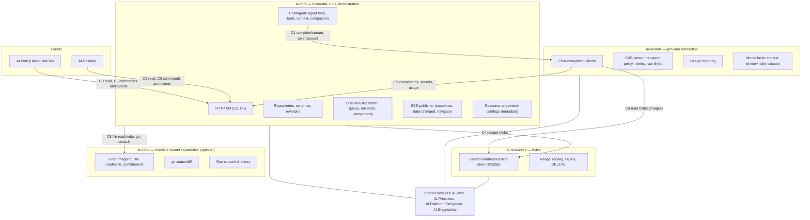
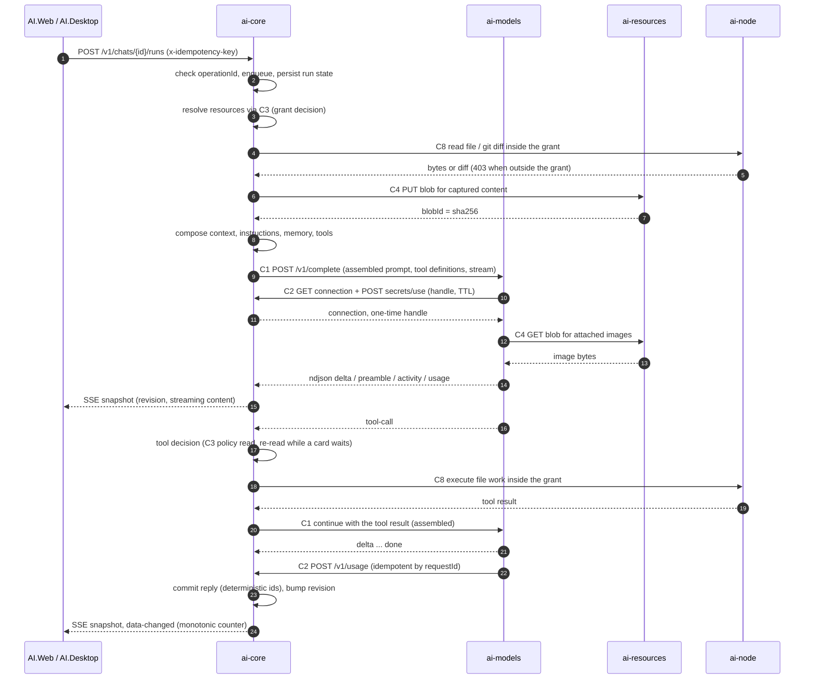

# 05 — Target design: three independently deployable components

Owner: Lead. Phase Ф3 of the redesign analysis. Inputs: the four area reports
([`01`](01-ai-models-current-state.md), [`02`](02-persistence-current-state.md),
[`03`](03-resources-current-state.md), [`04`](04-contracts-and-shared-parts.md)) and the frozen
decisions of the team's lead branch. Current-state statements carry `path:line`; anything not
verified in code is marked `assumption:` or `external:`.

## 1. What the design has to achieve

1. **Independently deployable.** Each component starts, is health-checked, fails and is upgraded on
   its own; a component's absence degrades a feature instead of preventing startup.
2. **Placeable on different machines.** No component may read another's file system, share another's
   lock, or assume another's clock beyond a stated tolerance.
3. **One answer per question.** One source of truth for metadata, one for bytes, one for runs, one
   for model traffic. No component keeps a second authoritative copy.
4. **No new consistency machinery.** At-least-once delivery, idempotency by a named key, no
   distributed transactions (the charter's `C7`).
5. **The split is a seam, not a rewrite.** The existing interfaces (`IChatCompletionClient`,
   `IFileSystem`, `IResourceAssetService`, the repositories) are the cut points; the product's
   behaviour, limits and rendering stay as they are.

## 2. The component map

### Component responsibilities

| Component | Owns | Explicitly does **not** own |
| --- | --- | --- |
| `ai-core` | The data directory and its lock; every metadata document; grants as logical, project-relative facts; the grant *decision*; run state, queues, idempotency; the agent loop, tool sessions and tool decisions; context planning and compaction; instruction and memory composition; SSE publication; resource and review catalogs; the browser-facing API; the change counter | Provider protocol details, provider retry policy, blob bytes, physical directories |
| `ai-models` | Provider protocol (OpenAI-compatible REST + SSE), transport policy and timeouts, retries and rate-limit observation, usage metering and reporting, model facts (capabilities, token counting), request body construction from an assembled prompt | Prompt assembly, context planning, compaction, tool execution, tool policy, metadata storage |
| `ai-resources` | Blob bytes, content addressing by `sha256(bytes)`, immutable blobs, range serving, blob metadata, deletion, (later) object-storage backing | Paths, grants, projects, `git`, scratch directories, browsers |
| `ai-node` *(optional seam, `C8`)* | Physical mapping of a logical grant to a local directory, link resolution and containment, file read/write inside a grant, `git status`/`diff`, run scratch space | Any metadata, any blob store, any model call |

The orchestrator is **not a fourth component**: the run dispatcher, the agent loop and the HTTP
surface stay inside `ai-core`, because the charter makes `ai-core` the source of truth for runs and
because the agent loop needs metadata on every step (decision D4).
`assumption:` placing the loop in `ai-core` rather than in `ai-models` was put to the user, who did
not answer within the time limit; it is the cheapest working arrangement and is revisable without
changing the envelope, only `C1`'s payload.

## 3. Deployment topologies

| Topology | Layout | What it buys | What it costs |
| --- | --- | --- | --- |
| **T1 — one machine** (default, today's behaviour) | All three components plus `ai-node` as separate processes on one host, loopback, `/healthz` per component | Real process isolation, independent upgrades, the split is exercised from day one | Three processes to supervise; local latency between components |
| **T2 — storage split** | `ai-core` + `ai-node` on the user's/orchestrator's machine; `ai-resources` on a storage host or object storage | Bytes stop competing with metadata for local disk; backups are per-domain | Blob latency inside a provider call; tickets must become stateless |
| **T3 — model split** | `ai-models` on a host with internet access; `ai-core` and `ai-resources` inside the network | Provider credentials and egress leave the data host; one place for rate limits across replicas | Secrets must be handed over (`C2`); model-host outage stops all model features |
| **T4 — full split** | T3 + `ai-resources` on cloud object storage, optional `ai-node` where directories live | The stated goal: three independently deployable components | All of the above plus the migration of stored absolute paths and a real authentication story |

Topology is a deployment decision, not a build-time one: all four are the same three components with
different environment configuration. That is the main reason the contracts are fixed before the first
component is extracted.

## 4. What moves where

| Today (`path:line`) | Target | Why |
| --- | --- | --- |
| `OpenAiCompatibleChatCompletionClient`, `ChatCompletionSseParser`, `ChatTransportPolicy`, `RetryingChatCompletionClient`, `MeteringChatCompletionClient`, usage readers and rate limits ([`Composition.cs:151-172`](file:///C:/Projects/DevTeam/AI.Client/src/AI.Server/Composition.cs#L151)) | `ai-models` | All provider-specific and provider-failure-specific |
| `IChatCompletionClient` in-process calls from `ChatAgent` ([`ChatAgent.cs:389`](file:///C:/Projects/DevTeam/AI.Client/src/AI.Server/Application/Tools/ChatAgent.cs#L389)) | `C1` HTTP/ndjson call | The existing interface is already two operations ([`IChatCompletionClient.cs:4-14`](file:///C:/Projects/DevTeam/AI.Client/src/AI.Server/Application/Chat/IChatCompletionClient.cs#L4)) |
| `ChatAgent`, tool sessions, `ToolPolicyResolver`, `ChatContextPlanner`, `ChatContextCompactor`, `ModelInstructionComposer`, `HistoryCheckpointService` | stay in `ai-core`, driven remotely by `C1`/`C2` | They need metadata per step; the loop and the tools are one object today ([`ChatAgent.cs:31`](file:///C:/Projects/DevTeam/AI.Client/src/AI.Server/Application/Tools/ChatAgent.cs#L31), [`:485`](file:///C:/Projects/DevTeam/AI.Client/src/AI.Server/Application/Tools/ChatAgent.cs#L485)) |
| `Json*Repository` family, `ProjectStorageLocation`, `DataDirectoryLock`, serializers, schema versions ([`02` §2.3–2.5](02-persistence-current-state.md)) | `ai-core` | One metadata root, one lock, one writer |
| `ResourceAssetService` blob and ticket tables ([`ResourceAssetService.cs:20-125`](file:///C:/Projects/DevTeam/AI.Client/src/AI.Server/Infrastructure/Storage/ResourceAssetService.cs#L20)) | bytes → `ai-resources`; tickets → `ai-core` as an authorization concern | Object-store keys are content-addressed; a ticket is authorization, not storage |
| `JsonResourceRepository`, `JsonReviewRepository` ([`JsonResourceRepository.cs:78`](file:///C:/Projects/DevTeam/AI.Client/src/AI.Server/Infrastructure/Storage/JsonResourceRepository.cs#L78), [`JsonReviewRepository.cs:86`](file:///C:/Projects/DevTeam/AI.Client/src/AI.Server/Infrastructure/Storage/JsonReviewRepository.cs#L86)) | `ai-core` metadata (D2) | Small JSON documents; kept with the rest of the metadata |
| `ProjectPathAccess`, `WorkspacePathResolver`, `PhysicalDirectoryBrowser`, `WorkspaceChangeTracker`, `GitBrowser`, `GitWorkspaceDiffReader`, `WorkspaceUndoService`, `ChatTemporaryDirectory`, `/api/filesystem/*` ([`03` §4.4](03-resources-current-state.md)) | `ai-node` (machine-bound) | Each needs a real local file system on the machine that owns the directory |
| Grant `CanonicalRoot` ([`02` §3.8 P1](02-persistence-current-state.md)) | logical `{grantId, logicalRoot, recursive, toolNames}` in `ai-core`; physical mapping registered by `ai-node` | An absolute path cannot be the meaning of a grant in a portable store |
| `AppDataChangeSignal` ([`AppDataChangeSignal.cs:7-30`](file:///C:/Projects/DevTeam/AI.Client/src/AI.Server/Application/Notifications/AppDataChangeSignal.cs#L7)) | `ai-core`-owned monotonic counter on the wire (D11) | A process-local counter means nothing to another component |
| `ChatRepositoryRouter`, `ChatRunRepositoryRouter`, `HostLifetimeChatRepository` ([`02` §2.8](02-persistence-current-state.md)) | policy in `ai-core`'s application layer; storage answers every read and write | Storage must not encode application routing |

## 5. Contracts

The full specification is [`04` §6](04-contracts-and-shared-parts.md). Frozen decisions that shape
it (D4–D13) are summarised here so the design can be read without that document:

| Contract | Parties | Content | Frozen points |
| --- | --- | --- | --- |
| `C1` | `ai-core` → `ai-models` | `POST /v1/complete` with an **assembled** prompt and tool definitions; ndjson events `delta`, `tool-call`, `usage`, `done`, `preamble`, `context`, `activity`, `transport-wait`, `error`; `POST /v1/tokens/count`; `GET /v1/connections/{id}/capabilities` | Prompt assembly stays in `ai-core`; `ai-models` reports model facts; each event carries `seq` and `revision`; no in-stream resume — a broken stream leaves a partial answer that is kept |
| `C2` | `ai-models` → `ai-core` | `GET /v1/connections/{id}`, `POST /v1/secrets/{name}/use` (one-time handle, TTL ≤ 60 s), `POST /v1/usage` (idempotent by `requestId`), `POST /v1/tool-decisions` | Secrets never travel as a value; a handle is used once (second use `409`) |
| `C3` | clients and `ai-models` → `ai-core` | Projects, chats, messages, branches, grants, `POST /v1/resources/resolve`, resource and review catalogs; `If-Match` revisions (`428` absent, `409` mismatch) | Grants are logical and live here; the grant decision is made **before** any bytes are touched; catalogs hold metadata and `blobId`, never diff bodies |
| `C4` | `ai-core`, `ai-models` → `ai-resources` | `PUT /v1/blobs` with `x-content-sha256`, `GET`/`HEAD`/`DELETE /v1/blobs/{blobId}`, ranges | `blobId = sha256(bytes)`; media type is metadata, not part of the id; a zero-length blob is legal; a re-hash mismatch on read is `500`, not `404`; no paths and no grants ever cross this API |
| `C5` | clients → `ai-core` | `POST /v1/chats/{chatId}/runs` with `x-idempotency-key`, run commands, tool decisions, prompt answers, `GET .../events?sinceRevision=` | Deterministic reply ids make a retried run produce one message; `sinceRevision` ahead of the current revision is `200` with no events, not an error |
| `C6` | all | Names, environment-provided ports and peer URLs, `GET /healthz` and `/readyz`, `x-ai-component`, node registration, the data-directory lock | One `ai-core` writer per metadata directory; bearer token per component/node over TLS, mTLS as the later goal; clock skew tolerance 5 s |
| `C7` | all | At-least-once delivery, idempotency keys, retry classification, ordering per branch | No distributed transactions; `ai-core` is the source of truth for runs; `ai-models` and `ai-resources` keep no authoritative state |
| `C8` | `ai-core`/`ai-models` → `ai-node` | Grant mapping registration, file read/write inside a grant, `git status`/`diff`, scratch allocation | Optional seam: when the node is absent the project simply has no local directory; containment failures are `403` from the node |

## 6. A run across the components

Failure reading of the same picture: if `ai-models` dies mid-stream, `ai-core` marks the branch
interrupted and keeps the partial answer; if `ai-node` is absent, the run proceeds without file
capabilities and the reference reads as "not available here"; if `ai-resources` is unreachable, new
captures fail but existing history still renders, because history holds metadata and blob ids.

## 7. Migration path

Ordered so that every step leaves the product working. Steps 1–5 are code work inside the monolith;
6–8 are the deployment split.

1. **Correct the documents and the shared modules.** Split `AI.Contracts` into `AI.Contracts.Core`,
   `.Models`, `.Resources` and `.Wire`; extract `AI.Primitives` (ids, clock), `AI.Wire` (envelope,
   error codes, `x-ai-component`, `x-idempotency-key`) and `AI.Platform.FileSystem`; write the
   component-neutral error envelope and map every real conflict onto it (today several are
   `ArgumentException` → 500). Fix `docs/04-storage.md`, which describes a layout the code does not
   have ([`02` §2.5](02-persistence-current-state.md)).
2. **One revision contract.** Replace the four conflicting revision shapes and the settings per-item
   compare with the `C3` shape; give the settings document and the run document revisions. Add the
   recovery step that today only `JsonProjectRepository` has.
3. **Logical grants, physical nodes.** Store `{grantId, logicalRoot, recursive, toolNames}` in the
   project document; introduce the node-side mapping and make every `CanonicalRoot` reader take its
   root from the resolver. Resolve links and check containment only inside the node.
4. **One blob addressing rule.** Make `blobId = sha256(bytes)`, move the media type into blob
   metadata, allow a zero-length blob, and re-hash every existing asset; undo blobs already conform
   ([`ResourceAssetService.cs:133-134`](file:///C:/Projects/DevTeam/AI.Client/src/AI.Server/Infrastructure/Storage/ResourceAssetService.cs#L133)).
   Promote the asset id to a global, project-independent blob id.
5. **Rewrite every stored path in one pass, before any data moves.** Chat document
   (`ChatResource.Path`), resource catalog, review catalog and undo manifest become
   `{grantId, relativePath}` or `{blobId}`; diff bodies leave metadata for the blob store; the old
   absolute spelling survives as a write-once display field. References with no portable answer —
   a path outside every grant, a client-side upload path, file names inside `ToolCalls[].Arguments` —
   keep the legacy string and are never resolved again
   ([`02` §3.9](02-persistence-current-state.md)). Publishers must keep reading the old format, as the
   chat reader already spans schemas 5–9.
6. **Extract the components as processes on one machine** (topology T1): `ai-core` behind `C3`/`C5`,
   `ai-models` behind `C1`/`C2`, `ai-resources` behind `C4`, `ai-node` behind `C8`. Introduce
   `/healthz`, `/readyz`, ports and peer URLs from the environment, the identity header and the
   bearer token; keep the loopback default for the all-in-one case.
7. **Move the optional pieces out of `ai-core`:** `ai-resources` to a storage host or object storage
   (T2), then `ai-models` to a host with provider access (T3).
8. **Only then** consider more than one `ai-core` writer per metadata directory, which needs a real
   compare-and-set store rather than a lock (out of scope for this design; D7 fixes one writer).

Each step has an acceptance check: 1–2 by the existing test suites plus new contract tests for the
envelope and revisions; 3–5 by migration fixtures that round-trip old documents into the new format
and back into rendering; 6 by a smoke run of a chat turn, a tool call and an image attachment across
processes; 7 by the same smoke run with one component stopped.

## 8. Pros and cons

### What the split buys

| Gain | Evidence in the current state |
| --- | --- |
| **Independent deployment and upgrade.** A model-protocol change no longer touches storage; a storage change no longer touches the model path | Provider quirks are already isolated in one client chain ([`OpenAiCompatibleChatCompletionClient.cs:23-30`](file:///C:/Projects/DevTeam/AI.Client/src/AI.Server/Infrastructure/Chat/OpenAiCompatibleChatCompletionClient.cs#L23)) |
| **Placement freedom.** Bytes can live where disk is cheap; provider egress can leave the data host | Bytes and metadata share one directory under one lock today, which forbids it |
| **Scalability where it is needed.** `ai-models` can be replicated for throughput; blob serving can be offloaded to an object store | Rate limits, learned costs and estimate samples are per-process today, so replicas each relearn ([`01` risk 4](01-ai-models-current-state.md)) |
| **A stated trust boundary.** Components authenticate; the node's file-system window stops relying on loopback | `/api/filesystem/*` is acceptable only because origins are loopback ([`FileSystemEndpoints.cs:9-27`](file:///C:/Projects/DevTeam/AI.Client/src/AI.Server/Hosting/Endpoints/FileSystemEndpoints.cs#L9)) |
| **Portability of history.** A chat stops naming content by a path on one machine | `ChatResource.Path` is documented as absolute today ([`ChatResource.cs:9-20`](file:///C:/Projects/DevTeam/AI.Client/src/AI.Contracts/Resources/ChatResource.cs#L9)) |
| **Reusability.** Wire, ids, file-system contract and diagnostics become modules with one owner each | One `AI.Contracts` assembly holds three components' DTOs ([`04` §4.2](04-contracts-and-shared-parts.md)) |

### What the split costs

| Cost | Mitigation in this design |
| --- | --- |
| **Every model step becomes a network call.** Seven call sites assemble a request by hand and would each have to speak `C1` | Assemble in one place inside `ai-core`; the seven sites shrink to one builder |
| **Latency inside a provider call.** Image bytes are fetched from `C4` while building the request | Fetch by blob id with a short cache; keep the reference, not the payload, in the run state |
| **Loss of in-process atomicity.** Read-modify-write is safe today only under one lock and one gate | One writer per metadata directory (D7); `If-Match` is the only authority; a real compare-and-set store is the price of a second writer |
| **Partial failures become normal.** A stream can break, a blob can be missing, a node can be offline | Degradation rules per seam: interrupted run keeps the partial answer; missing node means "no local directory"; unreachable blob store fails new captures only |
| **Streaming cost.** Every delta would be a message unless batched | Events carry `seq`/`revision`; the client ignores duplicates; the existing 250 ms damping stays on the `ai-core` side |
| **Migration risk.** Ten stored formats carry absolute paths and the rewrite is one-way | One pass, before any data moves, with the legacy spelling kept for display; old formats stay readable |
| **More moving parts to operate.** Three components plus a node agent, each with health, ports and identity | `/healthz`/`/readyz` per component, environment-driven configuration, and topology T1 on one machine as the default |
| **Secrets change shape.** A key that is decryptable only by one OS account cannot be read by a remote model host | `C2` one-time handles: `ai-core` keeps the secret and the decryption, `ai-models` gets a handle with a TTL |
| **Two addressing schemes must not be reintroduced.** The byte store is content-addressed, the node is path-addressed | Stated as a rule in `C4` (no paths) and `C8` (no blobs); the boundary is the reason the node agent is a separate seam rather than a fourth component |

### Risks that remain open after this design

- **UUIDv7 ordering across machines** depends on clock skew; the design bounds it at 5 s and forbids
  using ids for ordering, but does not remove the dependency (`external:` NTP).
- **Object-store semantics** (ETag, multipart, list consistency, presigned URL expiry) are still
  assumptions: no such code exists in the repository today.
- **A second `ai-core` writer** is deliberately out of scope; today's revision checks would lose
  updates silently across processes.
- **Orphaned blobs and retained nodes**: there is no garbage collector today, and an object store
  makes retained bytes a cost rather than a local inconvenience.

## 9. Alternatives considered

| Alternative | Why not |
| --- | --- |
| **Keep the monolith, split nothing** | It cannot satisfy "different machines": one lock, one directory and one process own metadata, bytes and model traffic together, and stored history names files by absolute path |
| **Two components (`ai-core` + `ai-models`), bytes stay local** | Cheapest first step and a legitimate staging point, but it keeps the byte layer path-addressed and node-bound, which is exactly what blocks S3/cloud |
| **Four components (a separate orchestrator/brain)** | The run dispatcher needs metadata on every step of the loop and every tool decision; separating it turns each step into two round trips and contradicts "`ai-core` is the source of truth for runs" |
| **`ai-models` hosts the agent loop** | Rejected in D4: the loop reads projects, chats, policies, memory and instructions constantly; moving it makes `C1`/`C5` much wider for no deployment gain |
| **`ai-resources` also serves project files and git** | Diffs, directory browsing and temp directories are machine-bound; folding them into a cloud-ready byte service would make the cloud backend impossible (D1) |
| **Microservice per feature area** | No evidence base for it and no requirement that asks for it; the stated goal is three independently deployable components |

## 10. Open questions and assumptions

1. `assumption:` the agent loop stays in `ai-core` (D4) and component trust is a bearer token over
   TLS with mTLS as a later goal (D5) — both were put to the user and not answered within the time
   limit; they are the recommended options and are revisable, the second without changing any
   contract shape.
2. The exact schema-migration shape for `ChatResource.Path` and the ordering of the catalogs'
   rewrite is specified as an approach, not as a script; it needs a migration fixture before it can
   be called done ([`02` §7.12](02-persistence-current-state.md)).
3. Whether `ai-node` becomes a truly separate binary or a capability of the orchestrator process is
   a deployment decision left open by `C8`.
4. Rate limiting across more than one `ai-models` replica: the contract does not yet say whether the
   windows live in `ai-core` or stay per replica.
5. Whether the review catalog keeps its `SourceChanges` copy during the transition or drops it in
   the same step as the blob extraction (Bo's `S2-21`).

## 11. Verification

- Every current-state claim in this document is traceable to a `path:line` in one of the four area
  reports or in the source at commit `7bb4d34` (branch `master`), verified by reading the code.
- The contract summary reproduces the frozen decisions D1–D13 recorded in the team's lead branch;
  the full specification and its edge cases are in [`04`](04-contracts-and-shared-parts.md).
- `external:` claims (S3 and object-store semantics, clock synchronisation, provider behaviour) are
  marked as assumptions, not as verified behaviour of this codebase.
- Nothing in `src/`, `tests/` or `build/` was changed by this analysis; no build or test run was
  required or performed, because every artefact is Markdown under `docs/analysis/redesign/`.
